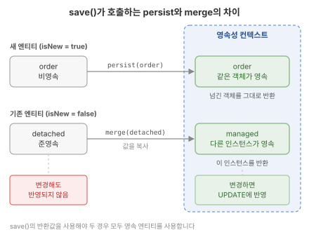
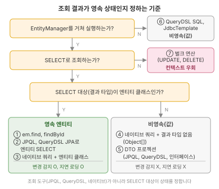

<!-- truncate -->

JPA에서는 엔티티를 조회한 뒤 필드만 변경하면 커밋 시점에 UPDATE가 실행되고(변경 감지), LAZY 연관관계에 접근하면 그때 추가 쿼리가 실행됩니다(지연 로딩). 두 기능 모두 **결과가 영속성 컨텍스트에 등록된 엔티티**일 때만 동작합니다. 그런데 조회 방법이 JPQL, QueryDSL, 네이티브 쿼리, DTO 프로젝션으로 다양해지면 "지금 받은 객체가 영속 상태인가"가 코드만 보고는 분명하지 않습니다.

<mark>기준은 **"`EntityManager`를 통해, 엔티티 타입으로 받은 결과인가"** 입니다. 조회 문법(JPQL, QueryDSL, 네이티브)과는 관계가 없습니다.</mark>

## 영속 상태란

영속성 컨텍스트는 `EntityManager`가 관리하는 **엔티티 저장소**입니다. 여기에 등록된 엔티티(영속 상태, managed)는 다음 기능을 사용할 수 있습니다.

- **1차 캐시와 동일성 보장** — 같은 트랜잭션에서 같은 ID로 조회하면 같은 인스턴스를 돌려줍니다.
- **변경 감지(dirty checking)** — 필드를 변경하면 flush 시점에 UPDATE가 실행됩니다.
- **지연 로딩** — LAZY 연관관계에 접근할 때 프록시가 쿼리를 실행해 값을 채웁니다.

엔티티는 네 가지 상태 중 한 가지입니다.

| 상태 | 설명 | 들어가는 방법 |
|---|---|---|
| 비영속(new/transient) | `new`로 만들었을 뿐, 컨텍스트와 무관 | `new Order()` |
| 영속(managed) | 컨텍스트가 관리 | `persist`, 조회 결과, `merge`의 반환값 |
| 준영속(detached) | 한때 영속이었지만 지금은 관리되지 않음 | `detach`, `clear`, `close`, 트랜잭션 종료 |
| 삭제(removed) | 삭제 예정 | `remove` |

엔티티 매니저와 영속성 컨텍스트의 기초는 [엔티티 매니저 wiki](/wiki/spring-data-jpa/jpa-entity-manager)에 정리돼 있습니다.

## 저장할 때의 기준 — `persist`와 `merge`

저장 쪽에서 헷갈리는 지점은 **`merge`가 넘긴 객체를 영속 상태로 만들지 않는다**는 점입니다.

```java
Order detached = ...;                 // 준영속 객체
Order managed = em.merge(detached);   // 영속 상태의 "복사본"을 반환

managed.changeStatus(PAID);    // 반영됨 (영속)
detached.changeStatus(PAID);   // 반영되지 않음 (여전히 준영속)
```

Spring Data JPA의 `save()`는 엔티티가 새것이면 `persist`, 아니면 `merge`를 호출합니다. 그래서 <mark>`save()`의 **반환값**을 사용해야 영속 엔티티를 사용한다는 것이 보장됩니다.</mark> 새 엔티티 판단 기준(`@Id`, `@Version`, `Persistable`)은 [새로운 Entity 판단 기준](/wiki/spring-data-jpa/jpa-new-entity)을 참고합니다.

```java
// spring-data-jpa: SimpleJpaRepository#save (발췌)
public <S extends T> S save(S entity) {
    ...
    if (entityInformation.isNew(entity)) {
        entityManager.persist(entity);
        return entity;
    } else {
        return entityManager.merge(entity);
    }
}
```

→ 새 엔티티면 넘긴 객체 자체가 영속 상태가 되고, 기존 엔티티면 `merge`가 돌려준 다른 인스턴스가 영속 상태입니다. ([SimpleJpaRepository.java](https://github.com/spring-projects/spring-data-jpa/blob/main/spring-data-jpa/src/main/java/org/springframework/data/jpa/repository/support/SimpleJpaRepository.java))

<details>
<summary>SVG 코드</summary>

```svg
<svg xmlns="http://www.w3.org/2000/svg" width="440" height="338" viewBox="0 0 440 338" font-family="-apple-system, 'Segoe UI', 'Noto Sans KR', sans-serif">
<defs><marker id="ah" viewBox="0 0 10 10" refX="9" refY="5" markerWidth="7" markerHeight="7" orient="auto-start-reverse"><path d="M0,0 L10,5 L0,10 z" fill="#888"/></marker></defs>
<rect x="0" y="0" width="440" height="338" fill="#FFFFFF"/>
<text x="220.0" y="22" font-size="13" fill="#333" text-anchor="middle" font-weight="bold">save()가 호출하는 persist와 merge의 차이</text>
<rect x="262" y="36" width="166" height="266" rx="8" fill="#EEF3FB" stroke="#4C7FE0" stroke-dasharray="4 3"/>
<text x="345.0" y="54" font-size="11" fill="#26508F" text-anchor="middle" font-weight="bold">영속성 컨텍스트</text>
<text x="14" y="70" font-size="10" fill="#555" text-anchor="start" font-weight="bold">새 엔티티 (isNew = true)</text>
<rect x="14" y="80" width="110" height="44" rx="6" fill="#F7F7F7" stroke="#999999"/>
<text x="69" y="98.4" font-size="10.5" fill="#333" text-anchor="middle">order</text>
<text x="69" y="112.9" font-size="10.5" fill="#333" text-anchor="middle">비영속</text>
<line x1="124" y1="102" x2="276" y2="102" stroke="#888" stroke-width="1.2" marker-end="url(#ah)"/>
<text x="193" y="96" font-size="9.5" fill="#555" text-anchor="middle" font-family="Menlo, Consolas, monospace">persist(order)</text>
<rect x="278" y="80" width="134" height="44" rx="6" fill="#E9F2E9" stroke="#8FBF8F" stroke-width="1.5"/>
<text x="345.0" y="98.4" font-size="10.5" fill="#2E6B2E" text-anchor="middle">order</text>
<text x="345.0" y="112.9" font-size="10.5" fill="#2E6B2E" text-anchor="middle">같은 객체가 영속</text>
<text x="345.0" y="140" font-size="9.5" fill="#555" text-anchor="middle">넘긴 객체를 그대로 반환</text>
<text x="14" y="166" font-size="10" fill="#555" text-anchor="start" font-weight="bold">기존 엔티티 (isNew = false)</text>
<rect x="14" y="176" width="110" height="44" rx="6" fill="#F7F7F7" stroke="#999999"/>
<text x="69" y="194.4" font-size="10.5" fill="#333" text-anchor="middle">detached</text>
<text x="69" y="208.9" font-size="10.5" fill="#333" text-anchor="middle">준영속</text>
<line x1="124" y1="198" x2="276" y2="198" stroke="#888" stroke-width="1.2" marker-end="url(#ah)"/>
<text x="193" y="192" font-size="9.5" fill="#555" text-anchor="middle" font-family="Menlo, Consolas, monospace">merge(detached)</text>
<text x="193" y="212" font-size="9.5" fill="#888" text-anchor="middle">값을 복사</text>
<rect x="278" y="176" width="134" height="44" rx="6" fill="#E9F2E9" stroke="#8FBF8F" stroke-width="1.5"/>
<text x="345.0" y="194.4" font-size="10.5" fill="#2E6B2E" text-anchor="middle">managed</text>
<text x="345.0" y="208.9" font-size="10.5" fill="#2E6B2E" text-anchor="middle">다른 인스턴스가 영속</text>
<text x="345.0" y="236" font-size="9.5" fill="#555" text-anchor="middle">이 인스턴스를 반환</text>
<rect x="14" y="250" width="110" height="42" rx="4" fill="#FDECEC" stroke="#D9534F"/>
<text x="69" y="267.5" font-size="10" fill="#B52B27" text-anchor="middle">변경해도</text>
<text x="69" y="281.5" font-size="10" fill="#B52B27" text-anchor="middle">반영되지 않음</text>
<line x1="69" y1="220" x2="69" y2="250" stroke="#CCC" stroke-width="1.2" stroke-dasharray="3 3"/>
<rect x="278" y="250" width="134" height="42" rx="4" fill="#E9F2E9" stroke="#8FBF8F"/>
<text x="345.0" y="267.5" font-size="10" fill="#2E6B2E" text-anchor="middle">변경하면</text>
<text x="345.0" y="281.5" font-size="10" fill="#2E6B2E" text-anchor="middle">UPDATE에 반영</text>
<line x1="345.0" y1="242" x2="345.0" y2="250" stroke="#CCC" stroke-width="1.2" stroke-dasharray="3 3"/>
<text x="14" y="326" font-size="9.5" fill="#888" text-anchor="start">save()의 반환값을 사용해야 두 경우 모두 영속 엔티티를 사용합니다</text>
</svg>
```

</details>

<figure style={{textAlign: 'center', margin: '1.5rem 0'}}>
  
</figure>

## 조회할 때의 기준 — 방법별 정리

같은 `orders` 테이블을 여러 방법으로 조회해 보고, 결과가 영속 상태인지 차례로 확인합니다.

아래 그림은 ①~⑦을 세 가지 질문으로 분류한 것입니다.

<details>
<summary>SVG 코드</summary>

```svg
<svg xmlns="http://www.w3.org/2000/svg" width="440" height="380" viewBox="0 0 440 380" font-family="-apple-system, 'Segoe UI', 'Noto Sans KR', sans-serif">
<defs><marker id="ah" viewBox="0 0 10 10" refX="9" refY="5" markerWidth="7" markerHeight="7" orient="auto-start-reverse"><path d="M0,0 L10,5 L0,10 z" fill="#888"/></marker></defs>
<rect x="0" y="0" width="440" height="380" fill="#FFFFFF"/>
<text x="220.0" y="22" font-size="13" fill="#333" text-anchor="middle" font-weight="bold">조회 결과가 영속 상태인지 정하는 기준</text>
<rect x="20" y="38" width="250" height="38" rx="6" fill="#FFF3E0" stroke="#E0A000"/>
<text x="145.0" y="61" font-size="11" fill="#333" text-anchor="middle">EntityManager를 거쳐 실행하는가?</text>
<line x1="270" y1="57" x2="294" y2="57" stroke="#888" stroke-width="1.2" marker-end="url(#ah)"/>
<text x="280.0" y="72" font-size="9.5" fill="#888" text-anchor="middle">N</text>
<rect x="296" y="32" width="134" height="50" rx="6" fill="#F7F7F7" stroke="#999999"/>
<text x="363.0" y="47.2" font-size="10.5" fill="#333" text-anchor="middle">⑥ QueryDSL SQL,</text>
<text x="363.0" y="60.2" font-size="10.5" fill="#333" text-anchor="middle">JdbcTemplate</text>
<text x="363.0" y="76" font-size="10.5" fill="#555555" text-anchor="middle" font-weight="bold">비영속(값)</text>
<line x1="145.0" y1="76" x2="145.0" y2="102" stroke="#888" stroke-width="1.2" marker-end="url(#ah)"/>
<text x="153.0" y="93" font-size="9.5" fill="#888" text-anchor="start">Y</text>
<rect x="20" y="102" width="250" height="38" rx="6" fill="#FFF3E0" stroke="#E0A000"/>
<text x="145.0" y="125" font-size="11" fill="#333" text-anchor="middle">SELECT로 조회하는가?</text>
<line x1="270" y1="121" x2="294" y2="121" stroke="#888" stroke-width="1.2" marker-end="url(#ah)"/>
<text x="280.0" y="136" font-size="9.5" fill="#888" text-anchor="middle">N</text>
<rect x="296" y="96" width="134" height="50" rx="6" fill="#FCE4EC" stroke="#D06A86"/>
<text x="363.0" y="111.2" font-size="10.5" fill="#333" text-anchor="middle">⑦ 벌크 연산</text>
<text x="363.0" y="124.2" font-size="10.5" fill="#333" text-anchor="middle">(UPDATE, DELETE)</text>
<text x="363.0" y="140" font-size="10.5" fill="#9E3A57" text-anchor="middle" font-weight="bold">컨텍스트 우회</text>
<line x1="145.0" y1="140" x2="145.0" y2="166" stroke="#888" stroke-width="1.2" marker-end="url(#ah)"/>
<text x="153.0" y="157" font-size="9.5" fill="#888" text-anchor="start">Y</text>
<rect x="60" y="166" width="320" height="38" rx="6" fill="#FFF3E0" stroke="#E0A000"/>
<text x="220" y="189" font-size="11" fill="#333" text-anchor="middle">SELECT 대상(결과 타입)이 엔티티 클래스인가?</text>
<line x1="117" y1="204" x2="117" y2="236" stroke="#888" stroke-width="1.2" marker-end="url(#ah)"/>
<text x="125" y="224" font-size="9.5" fill="#888" text-anchor="start">Y</text>
<line x1="323" y1="204" x2="323" y2="236" stroke="#888" stroke-width="1.2" marker-end="url(#ah)"/>
<text x="331" y="224" font-size="9.5" fill="#888" text-anchor="start">N</text>
<rect x="17" y="236" width="200" height="112" rx="6" fill="#E9F2E9" stroke="#8FBF8F" stroke-width="1.5"/>
<text x="117.0" y="254" font-size="11.5" fill="#2E6B2E" text-anchor="middle" font-weight="bold">영속 엔티티</text>
<text x="27" y="274" font-size="10.5" fill="#333" text-anchor="start">① em.find, findById</text>
<text x="27" y="289" font-size="10.5" fill="#333" text-anchor="start">② JPQL, QueryDSL JPA로</text>
<text x="41" y="304" font-size="10.5" fill="#333" text-anchor="start">엔티티 SELECT</text>
<text x="27" y="319" font-size="10.5" fill="#333" text-anchor="start">③ 네이티브 쿼리 + 엔티티 클래스</text>
<line x1="27" y1="324" x2="207" y2="324" stroke="#CCC" stroke-width="1.2"/>
<text x="117.0" y="339" font-size="10" fill="#2E6B2E" text-anchor="middle">변경 감지 O, 지연 로딩 O</text>
<rect x="223" y="236" width="200" height="112" rx="6" fill="#F7F7F7" stroke="#999999"/>
<text x="323.0" y="254" font-size="11.5" fill="#555555" text-anchor="middle" font-weight="bold">비영속(값)</text>
<text x="233" y="274" font-size="10.5" fill="#333" text-anchor="start">④ 네이티브 쿼리 + 결과 타입 없음</text>
<text x="247" y="289" font-size="10.5" fill="#333" text-anchor="start">(Object[])</text>
<text x="233" y="304" font-size="10.5" fill="#333" text-anchor="start">⑤ DTO 프로젝션</text>
<text x="247" y="319" font-size="10.5" fill="#333" text-anchor="start">(JPQL, QueryDSL, 인터페이스)</text>
<line x1="233" y1="324" x2="413" y2="324" stroke="#CCC" stroke-width="1.2"/>
<text x="323.0" y="339" font-size="10" fill="#555555" text-anchor="middle">변경 감지 X, 지연 로딩 X</text>
<text x="220.0" y="368" font-size="9.5" fill="#888" text-anchor="middle">조회 도구(JPQL, QueryDSL, 네이티브)가 아니라 SELECT 대상이 상태를 정합니다</text>
</svg>
```

</details>

<figure style={{textAlign: 'center', margin: '1.5rem 0'}}>
  
</figure>

### ① `em.find`, Spring Data JPA `findById` — 영속

`em.find`는 영속성 컨텍스트를 먼저 확인하고, 없으면 DB에서 읽어 **등록한 뒤** 돌려줍니다.

### ② JPQL, QueryDSL JPA로 엔티티를 SELECT — 영속

```java
List<Order> a = em.createQuery("select o from Order o", Order.class)
                  .getResultList();

List<Order> b = queryFactory.selectFrom(order)
                            .fetch();
```

QueryDSL JPA는 JPQL로 변환돼 `EntityManager`에서 실행되므로 JPQL과 결과가 같습니다. 두 방법 모두 결과 행으로 만든 엔티티를 영속성 컨텍스트에 등록합니다.

> **이미 컨텍스트에 같은 ID 엔티티가 있으면?**
>
> JPQL은 1차 캐시를 확인하지 않고 **항상 SQL을 실행**합니다. 그 뒤 같은 ID의 엔티티가 이미 영속 상태라면 **새로 읽은 행은 버리고 기존 인스턴스를 반환**합니다. 그래서 같은 트랜잭션에서 아직 flush하지 않은 변경이 있어도 조회 결과로 덮어쓰이지 않고, 동일성(`a.get(0) == b.get(0)`)이 유지됩니다.

### ③ 네이티브 쿼리 + 엔티티 클래스 — 영속

네이티브 SQL이라도 **결과 타입을 엔티티 클래스로 지정**하면 영속 상태가 됩니다.

```java
List<Order> orders = em.createNativeQuery("select * from orders where status = 'PAID'", Order.class)
                       .getResultList();
```

```java
// Spring Data JPA — 반환 타입이 엔티티면 동일
@Query(value = "select * from orders where status = 'PAID'", nativeQuery = true)
List<Order> findPaidNative();
```

결과 컬럼이 엔티티 매핑의 모든 컬럼을 포함해야 하고, 빠진 컬럼이 있으면 매핑 단계에서 예외가 발생합니다.

### ④ 네이티브 쿼리 + 결과 타입 없음 — 비영속(값)

같은 네이티브 쿼리라도 **결과 타입을 지정하지 않으면** 엔티티가 아니라 컬럼 값 배열(`Object[]`)을 돌려줍니다. ③과의 차이는 `createNativeQuery`의 두 번째 인자(`Order.class`)가 있는지뿐입니다.

```java
String sql = "select * from orders where status = 'PAID'";

// ③ 결과 타입 지정 → 영속 엔티티
List<Order> orders = em.createNativeQuery(sql, Order.class).getResultList();

// ④ 결과 타입 없음 → 한 행이 Object[] (컬럼이 하나면 Object)
List<Object[]> rows = em.createNativeQuery(sql).getResultList();
```

④의 결과는 SELECT한 컬럼 순서대로 인덱스로 값을 읽습니다.

```java
List<Object[]> rows = em.createNativeQuery("select id, status from orders where status = 'PAID'")
                        .getResultList();

for (Object[] row : rows) {
    Long id = ((Number) row[0]).longValue();
    String status = (String) row[1];
    // row는 값이라 변경해도 UPDATE가 실행되지 않고, 연관관계도 없다
}
```

```java
// Spring Data JPA — 반환 타입이 엔티티가 아니면 동일하게 값
@Query(value = "select id, status from orders where status = 'PAID'", nativeQuery = true)
List<Object[]> findPaidRows();
```

<mark>④의 `row`는 영속성 컨텍스트에 등록되지 않습니다.</mark> 이 `id`로 엔티티가 필요하면 `em.find(Order.class, id)`를 따로 호출해야 하고, 그때 `Order`가 영속 상태로 조회됩니다(이미 컨텍스트에 있으면 그 인스턴스를 반환).

### ⑤ DTO 프로젝션 — 비영속(값)

```java
// JPQL 생성자 표현식
em.createQuery("select new com.example.OrderSummary(o.id, o.amount) from Order o", OrderSummary.class);

// QueryDSL JPA
queryFactory.select(Projections.constructor(OrderSummary.class, order.id, order.amount))
            .from(order)
            .fetch();
```

DTO는 엔티티가 아니므로 영속성 컨텍스트에 등록되지 않습니다. 필드를 변경해도 UPDATE가 실행되지 않고, 연관관계도 없습니다. Spring Data JPA의 인터페이스 프로젝션(`interface OrderView { Long getId(); }`)도 선택한 값만 가진 객체라 같은 결과입니다.

<mark>같은 QueryDSL JPA라도 `selectFrom(order)`는 영속 엔티티를, `select(Projections...)`는 단순 값을 돌려줍니다 — **조회 도구가 아니라 SELECT 대상이 결과의 상태를 정합니다.**</mark>

### ⑥ QueryDSL SQL, `JdbcTemplate` — 비영속(값)

JPA를 거치지 않으므로 결과는 항상 영속성 컨텍스트와 무관합니다. 결과를 엔티티 클래스에 담더라도 그 객체는 `new`로 만든 것과 같은 비영속 객체입니다. 두 QueryDSL 모듈의 실행 경로 차이는 [Spring Data JPA, QueryDSL JPA, QueryDSL SQL은 어떻게 다른가](/blog/querydsl-jpa-vs-sql-spring-data-jpa)에서 설명했습니다.

### ⑦ 벌크 연산 — 컨텍스트를 우회

`update`, `delete` JPQL(벌크 연산)은 영속성 컨텍스트를 거치지 않고 **DB를 직접 수정**합니다. 이미 영속 상태인 엔티티는 변경된 값을 반영하지 못한 채 남습니다.

```java
Order o = em.find(Order.class, 1L);               // status = READY
em.createQuery("update Order o set o.status = 'PAID'")
  .executeUpdate();
o.getStatus();                                     // 여전히 READY (컨텍스트 값)
```

Spring Data JPA에서는 `@Modifying(clearAutomatically = true)`로 벌크 연산 후 컨텍스트를 비워, 다음 조회가 DB 값을 읽게 합니다.

### 방법별 요약

| 조회 방법 | 결과 | 변경 감지 | 지연 로딩 |
|---|---|---|---|
| `em.find`, `findById` | 영속 엔티티 | O | O |
| JPQL, QueryDSL JPA로 엔티티 SELECT | 영속 엔티티 | O | O |
| 네이티브 쿼리 + 엔티티 클래스 | 영속 엔티티 | O | O |
| 결과 타입 없는 네이티브 쿼리 | `Object[]` | X | X |
| DTO 프로젝션(JPQL, QueryDSL, 인터페이스) | 값 | X | X |
| QueryDSL SQL, `JdbcTemplate` | 값 | X | X |

> **영속 상태인데 변경 감지가 되지 않는 경우**
>
> Hibernate의 읽기 전용 힌트(`org.hibernate.readOnly`)나 Spring의 `@Transactional(readOnly = true)`로 조회한 엔티티는 **영속 상태이지만 스냅샷을 만들지 않아** 변경 감지 대상에서 빠집니다. 지연 로딩과 1차 캐시는 그대로 동작합니다. 조회 전용 화면에서 메모리를 줄이려고 사용하는 설정이고, 이 상태에서 필드를 변경해도 UPDATE는 실행되지 않습니다.

## 연관관계 로딩은 방법마다 되나

연관관계 로딩은 두 가지로 나눠 봐야 합니다.

- **지연 로딩(나중에 접근할 때 로딩)** — 결과가 **영속 엔티티이기만 하면** 조회 방법과 상관없이 동작합니다. 네이티브 쿼리로 가져온 엔티티도 LAZY 연관에 접근하면 추가 쿼리가 실행됩니다.
- **즉시 로딩(조회 시점에 함께 로딩)** — 연관 엔티티를 **같은 쿼리에서 함께 영속화하는 장치**가 있어야 합니다. 이 장치는 조회 방법마다 다릅니다.

| 조회 방법 | 지연 로딩 | 한 쿼리로 함께 로딩 |
|---|---|---|
| Spring Data JPA | O | `@EntityGraph` 또는 `@Query`의 `join fetch` |
| JPQL | O | `join fetch` |
| QueryDSL JPA | O | `.join(...).fetchJoin()` |
| 네이티브 쿼리 + 엔티티 클래스 | O | fetch join 문법 없음 (Hibernate `addJoin` 등 구현체 API로만 가능) |
| DTO 프로젝션 | X | 조인 후 필요한 값을 SELECT (엔티티 로딩이 아님) |
| QueryDSL SQL | X (연관관계 개념 없음) | SQL 조인으로 값만 조회 |

<mark>지연 로딩은 "영속 엔티티인가"로, 즉시 로딩은 "fetch join에 해당하는 장치가 있는가"로 판단합니다.</mark> 그리고 지연 로딩은 **영속성 컨텍스트가 열려 있을 때만** 가능하므로, 트랜잭션이 끝난 뒤(준영속) 접근하면 `LazyInitializationException`이 발생합니다.

방법별 코드와 "조인했는데 왜 로딩되지 않나" 같은 착각 사례는 [JPA 연관관계 즉시 로딩](/blog/jpa-eager-loading-associations)에서 실제 쿼리와 함께 정리했습니다.

## 정리

- 결과가 영속 상태인지는 **`EntityManager`를 통해 엔티티 타입으로 받았는지**로 정해집니다. JPQL, QueryDSL JPA, 네이티브 쿼리 모두 엔티티를 SELECT하면 영속 상태입니다.
- **DTO 프로젝션, QueryDSL SQL, `JdbcTemplate`** 결과는 값이라 변경 감지와 지연 로딩이 없습니다.
- `merge`와 `save()`는 **반환값**이 영속 엔티티입니다.
- JPQL은 항상 SQL을 실행하지만, 이미 영속 상태인 엔티티는 **기존 인스턴스를 유지**합니다. 반대로 벌크 연산은 컨텍스트를 우회하므로 이후 조회 전에 컨텍스트를 비웁니다.
- 지연 로딩은 영속 엔티티라면 어떤 방법이든 동작하고, 즉시 로딩은 `join fetch`, `fetchJoin()`, `@EntityGraph`처럼 **명시적인 장치**가 필요합니다.

## 참고

- [Jakarta Persistence 3.1 명세 — 3.2 Entity Instance's Life Cycle](https://jakarta.ee/specifications/persistence/3.1/jakarta-persistence-spec-3.1.html)
- [Hibernate ORM User Guide — Persistence Contexts](https://docs.hibernate.org/orm/6.6/userguide/html_single/Hibernate_User_Guide.html)
- [Spring Data JPA — Modifying Queries](https://docs.spring.io/spring-data/jpa/reference/jpa/query-methods.html#jpa.modifying-queries)
