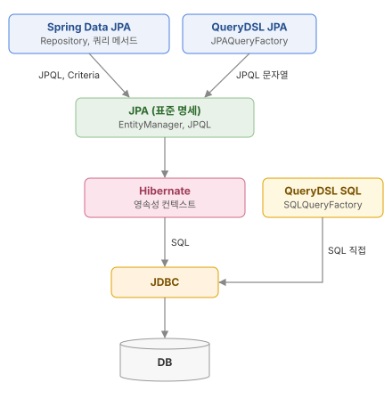

<!-- truncate -->

JPA 프로젝트에서 조회 코드를 작성하다 보면 Spring Data JPA, QueryDSL, JPQL, 네이티브 쿼리가 한 저장소 안에 함께 사용되고 있습니다. 여기에 QueryDSL이 **JPA 모듈과 SQL 모듈** 두 가지라는 사실까지 더해지면 "무엇이 무엇 위에서 동작하는지"가 헷갈리기 쉽습니다. 이 글은 세 기술의 위치를 레이어 기준으로 정리하고, 어떤 상황에 무엇을 선택하는지 살펴봅니다.

<mark>판단 기준은 **"그 쿼리가 `EntityManager`(영속성 컨텍스트)를 거치는가"** 한 가지입니다 — Spring Data JPA와 QueryDSL JPA는 거치고, QueryDSL SQL은 거치지 않습니다.</mark>

## JPQL은 어디에 속하나 — JPA 명세

JPQL(Java Persistence Query Language)은 **JPA 표준 명세에 정의된 쿼리 언어**입니다. Jakarta Persistence 명세 4장 "Query Language"가 문법과 의미를 규정하고, Hibernate, EclipseLink 같은 구현체가 이를 해석해 SQL로 변환합니다.

- **JPQL** — JPA 명세 소속. 테이블과 컬럼이 아니라 **엔티티와 필드**를 대상으로 작성합니다.
- **HQL** — Hibernate 소속. JPQL을 포함하는 상위 집합입니다.
- **Spring Data JPA, QueryDSL** — 어느 쪽도 JPQL을 "소유"하지 않습니다. JPQL을 **만들어서 `EntityManager`에 넘기는 쪽**입니다.

```java
// JPQL — 엔티티 Order와 필드 status를 대상으로 작성
String jpql = "select o from Order o where o.status = :status";
List<Order> orders = em.createQuery(jpql, Order.class)
                       .setParameter("status", OrderStatus.PAID)
                       .getResultList();
```

JPA와 Hibernate의 관계(명세와 구현체)는 [JPA와 Hibernate는 무슨 관계인가](/blog/jpa-vs-hibernate-relationship)에서 자세히 설명했습니다.

## 세 기술의 위치

<details>
<summary>SVG 코드</summary>

```svg
<svg xmlns="http://www.w3.org/2000/svg" width="440" height="448" viewBox="0 0 440 448" font-family="-apple-system, 'Segoe UI', 'Noto Sans KR', sans-serif">
<defs><marker id="ah" viewBox="0 0 10 10" refX="9" refY="5" markerWidth="7" markerHeight="7" orient="auto-start-reverse"><path d="M0,0 L10,5 L0,10 z" fill="#888"/></marker></defs>
<rect x="0" y="0" width="440" height="448" fill="#FFFFFF"/>
<rect x="10" y="16" width="180" height="44" rx="6" fill="#EEF3FB" stroke="#4C7FE0"/>
<text x="100.0" y="34.5" font-size="12" fill="#26508F" text-anchor="middle" font-weight="bold">Spring Data JPA</text>
<text x="100.0" y="49.5" font-size="10.5" fill="#555" text-anchor="middle">Repository, 쿼리 메서드</text>
<rect x="205" y="16" width="150" height="44" rx="6" fill="#EEF3FB" stroke="#4C7FE0"/>
<text x="280.0" y="34.5" font-size="12" fill="#26508F" text-anchor="middle" font-weight="bold">QueryDSL JPA</text>
<text x="280.0" y="49.5" font-size="10.5" fill="#555" text-anchor="middle">JPAQueryFactory</text>
<rect x="85" y="110" width="200" height="44" rx="6" fill="#E9F2E9" stroke="#8FBF8F"/>
<text x="185.0" y="128.5" font-size="12" fill="#2E6B2E" text-anchor="middle" font-weight="bold">JPA (표준 명세)</text>
<text x="185.0" y="143.5" font-size="10.5" fill="#555" text-anchor="middle">EntityManager, JPQL</text>
<rect x="95" y="200" width="180" height="44" rx="6" fill="#FCE4EC" stroke="#D06A86"/>
<text x="185.0" y="218.5" font-size="12" fill="#9E3A57" text-anchor="middle" font-weight="bold">Hibernate</text>
<text x="185.0" y="233.5" font-size="10.5" fill="#555" text-anchor="middle">영속성 컨텍스트</text>
<rect x="295" y="200" width="135" height="44" rx="6" fill="#FFF8E1" stroke="#E0A000"/>
<text x="362.5" y="218.5" font-size="12" fill="#7A5200" text-anchor="middle" font-weight="bold">QueryDSL SQL</text>
<text x="362.5" y="233.5" font-size="10.5" fill="#555" text-anchor="middle">SQLQueryFactory</text>
<rect x="125" y="300" width="120" height="34" rx="6" fill="#FFF3E0" stroke="#E0A000"/>
<text x="185.0" y="321.0" font-size="12" fill="#7A5200" text-anchor="middle" font-weight="bold">JDBC</text>
<path d="M135.0,386 A50.0,6 0 0 1 235.0,386 L235.0,422 A50.0,6 0 0 1 135.0,422 Z" fill="#F7F7F7" stroke="#999999"/>
<path d="M135.0,386 A50.0,6 0 0 0 235.0,386" fill="none" stroke="#999999"/>
<text x="185" y="411.0" font-size="12" fill="#333" text-anchor="middle" font-weight="bold">DB</text>
<line x1="100" y1="60" x2="145" y2="109" stroke="#888" stroke-width="1.2" marker-end="url(#ah)"/>
<text x="112" y="88" font-size="10.5" fill="#333" text-anchor="end">JPQL, Criteria</text>
<line x1="280" y1="60" x2="230" y2="109" stroke="#888" stroke-width="1.2" marker-end="url(#ah)"/>
<text x="265" y="88" font-size="10.5" fill="#333" text-anchor="start">JPQL 문자열</text>
<line x1="185" y1="154" x2="185" y2="199" stroke="#888" stroke-width="1.2" marker-end="url(#ah)"/>
<line x1="185" y1="244" x2="185" y2="299" stroke="#888" stroke-width="1.2" marker-end="url(#ah)"/>
<text x="192" y="276" font-size="10.5" fill="#333" text-anchor="start">SQL</text>
<polyline points="362,244 362,317 246,317" fill="none" stroke="#888" stroke-width="1.2" marker-end="url(#ah)"/>
<text x="368" y="285" font-size="10.5" fill="#333" text-anchor="start">SQL 직접</text>
<line x1="185" y1="334" x2="185" y2="379" stroke="#888" stroke-width="1.2" marker-end="url(#ah)"/>
</svg>
```

</details>

<figure style={{textAlign: 'center', margin: '1.5rem 0'}}>
  
</figure>

그림에서 왼쪽 두 기술(Spring Data JPA, QueryDSL JPA)은 모두 JPA로 내려가 **같은 영속성 컨텍스트**를 사용합니다. 오른쪽 QueryDSL SQL은 JPA, Hibernate를 지나지 않고 **JDBC를 바로** 호출합니다. <mark>그래서 Spring Data JPA와 QueryDSL JPA는 한 트랜잭션에서 함께 사용해도 엔티티를 공유하지만, QueryDSL SQL의 결과는 영속성 컨텍스트와 무관한 값입니다.</mark>

## Spring Data JPA vs QueryDSL JPA — 대체가 아니라 조합

두 기술은 **맡는 일이 다릅니다.**

| 구분 | Spring Data JPA | QueryDSL JPA |
|---|---|---|
| 하는 일 | 리포지토리 구현을 자동 생성 | 타입 안전한 JPQL을 코드로 작성 |
| 쿼리 작성 방식 | 메서드 이름 파생, `@Query`(JPQL 문자열) | `Q` 타입 + 메서드 체인 |
| 오타 발견 시점 | `@Query` 문자열은 애플리케이션 기동 시 | 컴파일 시 |
| 동적 조건 | `Specification` 등으로 가능하지만 장황함 | `BooleanBuilder`, `where(null 무시)`로 간결 |
| 실행 경로 | `EntityManager` | `EntityManager` |

Spring Data JPA의 `SimpleJpaRepository`는 내부에서 `EntityManager`를 그대로 호출합니다. 예를 들어 `findById`는 `em.find`입니다.

```java
// spring-data-jpa: SimpleJpaRepository#findById (발췌)
public Optional<T> findById(ID id) {
    ...
    if (metadata == null) {
        return Optional.ofNullable(entityManager.find(domainType, id));
    }
    ...
}
```

→ Spring Data JPA는 JPA 위의 편의 계층이고, 실제 조회는 JPA가 수행합니다. ([SimpleJpaRepository.java](https://github.com/spring-projects/spring-data-jpa/blob/main/spring-data-jpa/src/main/java/org/springframework/data/jpa/repository/support/SimpleJpaRepository.java))

QueryDSL JPA도 마찬가지입니다. 메서드 체인으로 만든 쿼리를 **JPQL 문자열로 직렬화**한 뒤 `EntityManager.createQuery`로 실행합니다.

```java
// querydsl-jpa: AbstractJPAQuery#createQuery (발췌)
protected Query createQuery(@Nullable QueryModifiers modifiers, boolean forCount) {
    JPQLSerializer serializer = serialize(forCount);
    String queryString = serializer.toString();
    ...
    Query query = entityManager.createQuery(queryString);
```

→ QueryDSL JPA는 "JPQL 빌더"입니다. JPQL로 표현할 수 없는 SQL(예: `FROM` 절 서브쿼리를 사용하는 구문)은 QueryDSL JPA로도 작성할 수 없습니다. ([AbstractJPAQuery.java](https://github.com/querydsl/querydsl/blob/master/querydsl-jpa/src/main/java/com/querydsl/jpa/impl/AbstractJPAQuery.java))

실무에서는 두 기술을 **한 리포지토리에 함께** 구성합니다. 단순 CRUD, 단건 조회는 Spring Data JPA에 맡기고, 조건이 많은 검색 쿼리만 커스텀 구현체에서 QueryDSL로 작성합니다.

```java
public interface OrderRepository
        extends JpaRepository<Order, Long>, OrderRepositoryCustom { }

public interface OrderRepositoryCustom {
    List<Order> search(OrderSearchCondition cond);
}

// 클래스 이름은 "인터페이스 이름 + Impl" 규칙을 따른다
class OrderRepositoryCustomImpl implements OrderRepositoryCustom {
    private final JPAQueryFactory queryFactory;

    OrderRepositoryCustomImpl(EntityManager em) {
        this.queryFactory = new JPAQueryFactory(em);
    }

    @Override
    public List<Order> search(OrderSearchCondition cond) {
        return queryFactory.selectFrom(order)
                           .where(statusEq(cond.status()),
                                  createdAfter(cond.from()))
                           .fetch();
    }

    // null을 반환하면 where 조건에서 제외된다
    private BooleanExpression statusEq(OrderStatus status) {
        return status == null ? null : order.status.eq(status);
    }

    private BooleanExpression createdAfter(LocalDateTime from) {
        return from == null ? null : order.createdAt.after(from);
    }
}
```

<mark>`OrderRepository`만으로 `save`, `findById`(Spring Data JPA)와 `search`(QueryDSL JPA)를 함께 호출할 수 있고, 두 경로 모두 같은 `EntityManager`를 사용합니다.</mark>

## QueryDSL JPA vs QueryDSL SQL

이름은 같은 QueryDSL이지만 **대상 언어와 실행 경로가 다른 모듈**입니다.

| 구분 | QueryDSL JPA (`querydsl-jpa`) | QueryDSL SQL (`querydsl-sql`) |
|---|---|---|
| 생성하는 쿼리 | JPQL | SQL (DB 방언별) |
| `Q` 타입 생성 원천 | `@Entity` 클래스 (애너테이션 프로세서) | DB 스키마 메타데이터 (코드 생성기가 테이블을 읽음) |
| 실행 경로 | `EntityManager` | JDBC `Connection` |
| 결과 | 엔티티(영속 상태) 또는 DTO | 값, DTO (엔티티 개념 없음) |
| 변경 감지, 지연 로딩 | 사용 가능 | 없음 |
| SQL 표현 범위 | JPQL 범위 내 | `union`, `FROM` 절 서브쿼리, 윈도우 함수 등 SQL 기능 대부분 |

QueryDSL SQL은 이렇게 사용합니다. `Q` 타입이 엔티티가 아니라 **테이블**을 나타냅니다.

```java
SQLQueryFactory sqlQueryFactory = new SQLQueryFactory(
        new Configuration(MySQLTemplates.builder().build()),
        dataSource);

QOrders o = QOrders.orders;   // DB 테이블 orders에서 생성된 Q 타입
ConstructorExpression<OrderSummary> summary =
        Projections.constructor(OrderSummary.class, o.memberId, o.amount.sum());
List<OrderSummary> rows = sqlQueryFactory.select(summary)
                                         .from(o)
                                         .groupBy(o.memberId)
                                         .fetch();
```

QueryDSL SQL이 유용한 경우는 다음과 같습니다.

- **통계, 리포트 쿼리** — 윈도우 함수, `union`, 복잡한 서브쿼리처럼 JPQL로 표현하기 어려운 SQL을 타입 안전하게 작성할 때.
- **엔티티가 없는 테이블** — 레거시 테이블이나 집계 테이블을 엔티티로 매핑하지 않고 조회만 할 때.
- **대량 처리** — 영속성 컨텍스트에 엔티티를 쌓지 않고 값만 읽어 메모리 사용을 줄일 때.

> **JPA 프로젝트에 QueryDSL SQL을 함께 사용하면 무엇을 주의하나?**
>
> QueryDSL SQL은 영속성 컨텍스트를 모르기 때문에 두 가지를 확인해야 합니다. ① **같은 트랜잭션의 커넥션을 사용하는지** — `querydsl-sql-spring`의 `SpringConnectionProvider`로 Spring 트랜잭션에 참여시켜야 JPA와 같은 트랜잭션에서 실행됩니다. ② **flush 전 변경은 보이지 않습니다** — JPA로 수정한 엔티티가 아직 flush되지 않았다면 QueryDSL SQL은 변경 전 값을 읽습니다. JPA의 JPQL, 네이티브 쿼리는 실행 전에 자동 flush가 발생하지만, JPA를 거치지 않는 QueryDSL SQL, `JdbcTemplate`에는 이 동작이 없으므로 필요하면 `em.flush()`를 먼저 호출합니다.

flush가 언제 발생하는지는 [JPA와 Hibernate에서 flush, commit, rollback은 언제 실행되나](/blog/jpa-hibernate-flush-commit-rollback-timing)에 정리돼 있습니다.

## 무엇을 고르나

상황별로 차례로 대입해 보면 다음과 같습니다.

1. **엔티티를 저장하거나 수정하고, 단건이나 단순 조건으로 조회한다** → Spring Data JPA. 쿼리 메서드와 `save`만으로 충분합니다.
2. **검색 조건이 동적으로 바뀌고 결과가 엔티티다** → QueryDSL JPA. Spring Data JPA의 `@Query`는 문자열이라 조건 조합이 어렵고, 결과를 엔티티로 받아 변경 감지까지 사용하려면 JPA 경로여야 합니다.
3. **통계, 집계처럼 JPQL로 표현하기 어려운 SQL이고 결과가 값이다** → QueryDSL SQL(또는 네이티브 쿼리). 영속성 컨텍스트가 필요 없고, JPQL 문법 제약을 받지 않습니다.

| 기술 | 실행 경로 | 결과가 영속 엔티티인가 | 주 용도 |
|---|---|---|---|
| Spring Data JPA | `EntityManager` | 예 (엔티티 조회 시) | CRUD, 단순 조회 |
| QueryDSL JPA | `EntityManager` | 예 (엔티티 조회 시) | 동적 검색 |
| QueryDSL SQL | JDBC | 아니오 | 통계, 복잡한 SQL |

> **QueryDSL 프로젝트 현황**
>
> 원 프로젝트(`com.querydsl`)는 5.x 이후 릴리스가 뜸해졌고, OpenFeign이 포크해 유지보수를 이어가는 `io.github.openfeign.querydsl`도 있습니다. 새로 도입한다면 사용하는 Spring Boot, Hibernate 버전과의 호환성을 두 프로젝트 기준으로 확인합니다.

## 정리

- **JPQL은 JPA 명세**에 속한 쿼리 언어이고, Hibernate는 이를 해석하는 구현체입니다. Spring Data JPA, QueryDSL JPA는 JPQL을 만들어 `EntityManager`에 넘기는 도구입니다.
- **Spring Data JPA와 QueryDSL JPA는 함께 사용합니다** — CRUD는 Spring Data JPA, 동적 검색은 QueryDSL JPA로 나누고, 둘 다 같은 영속성 컨텍스트를 사용합니다.
- **QueryDSL SQL은 JPA를 거치지 않습니다** — 결과는 영속 엔티티가 아니고, 자동 flush도 발생하지 않습니다. JPQL로 어려운 SQL이 필요할 때 선택합니다.

## 참고

- [Jakarta Persistence 3.1 명세 — 4장 Query Language](https://jakarta.ee/specifications/persistence/3.1/jakarta-persistence-spec-3.1.html)
- [Spring Data JPA — Custom Repository Implementations](https://docs.spring.io/spring-data/jpa/reference/repositories/custom-implementations.html)
- [Querydsl Reference — Querying JPA / Querying SQL](http://querydsl.com/static/querydsl/latest/reference/html/)
- [OpenFeign Querydsl](https://github.com/OpenFeign/querydsl)
