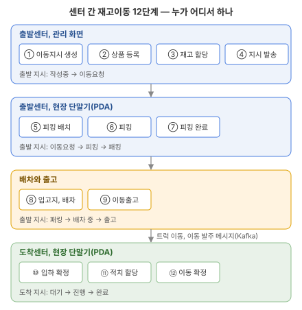
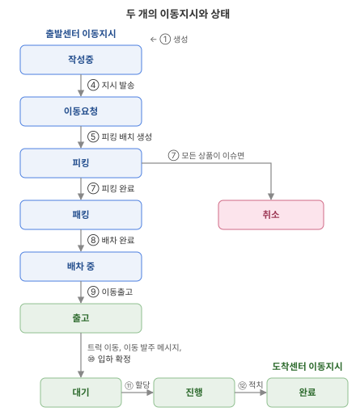
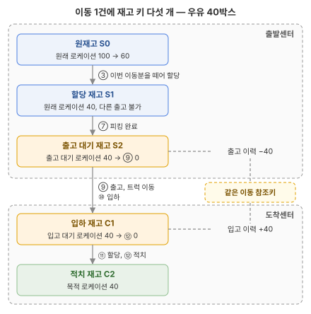
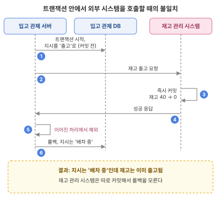

import AnatomyEmbed from '@site/src/components/AnatomyEmbed';

같은 회사의 물류센터끼리 재고를 이동하는 일을 **센터 간 재고이동**이라고 합니다. 겉보기엔 "트럭에 싣고 옮긴다" 한 줄이지만, 시스템 안에서는 출발센터의 **출고**와 도착센터의 **입고**가 한 번에 발생합니다. 이 글은 우유 40박스가 A센터에서 B센터로 이동하는 과정을 12단계로 따라가며, 단계마다 지시 상태와 재고가 어떻게 바뀌는지 정리합니다.

<!-- truncate -->

<mark>센터 간 재고이동은 출발센터의 출고 과정과 도착센터의 입고 과정을 하나의 이동으로 합친 것입니다 — 그래서 두 센터의 지시와 재고를 끝까지 하나로 이어 주는 값이 핵심입니다.</mark>

공급사에서 물건이 들어오는 입고 흐름은 [물류 SCM 시스템, 우유 100박스로 이해하기](./scm-system-explained)에서 설명했습니다. 이 글은 그 다음 이야기입니다. 예로 든 이름, 상태, 수치는 이해를 돕기 위한 것이고 실제 시스템과 다를 수 있습니다.

## 센터 간 재고이동이 뭔가요?

동네 마트 두 지점으로 비유하면 이렇습니다. 강남점에는 우유가 남고 잠실점에는 모자라면, 공급사에 새로 주문하지 않고 강남점 우유를 잠실점으로 옮깁니다. 물류센터도 같습니다. 한 센터에 재고가 몰리거나 다른 센터의 주문이 늘면 센터끼리 재고를 옮깁니다.

공급사 입고와 다른 점은 **보내는 쪽도 우리 센터**라는 것입니다. 그래서 출발센터는 고객 주문을 출고할 때처럼 재고를 할당하고, 집고, 싣고, 내보내야 합니다. 도착센터는 공급사 입고처럼 받고, 확인하고, 제자리에 넣어야 합니다.

이 글에서 일하는 주체는 네 가지입니다.

| 주체 | 하는 일 |
|---|---|
| **관리 화면** | 사무실 담당자가 이동지시를 만들고 상품을 등록하는 웹 화면 |
| **현장 단말기(PDA)** | 작업자가 들고 다니며 바코드를 스캔하고 작업을 확정하는 기기 |
| **입고 관제 시스템** | 이동지시와 상태를 관리하는 시스템. 지시의 "서류"를 맡음 |
| **재고 관리 시스템** | 로케이션별 실제 재고를 관리하는 시스템. 재고의 "실물 장부"를 맡음 |

지시는 입고 관제 시스템에, 재고는 재고 관리 시스템에 기록됩니다. 한 번의 이동이 **두 시스템에 나눠 기록된다**는 점을 기억해 두면 뒤의 내용이 쉽게 이해됩니다.

## 12단계 한눈에

<details>
<summary>SVG 코드</summary>

```svg
<svg xmlns="http://www.w3.org/2000/svg" width="440" height="452" viewBox="0 0 440 452" font-family="-apple-system, 'Segoe UI', 'Noto Sans KR', sans-serif">
<defs><marker id="ah" viewBox="0 0 10 10" refX="9" refY="5" markerWidth="7" markerHeight="7" orient="auto-start-reverse"><path d="M0,0 L10,5 L0,10 z" fill="#888"/></marker></defs>
<rect x="0" y="0" width="440" height="452" fill="#FFFFFF"/>
<text x="220" y="22" font-size="13" fill="#333" text-anchor="middle" font-weight="bold">센터 간 재고이동 12단계 — 누가 어디서 하나</text>
<rect x="16" y="36" width="408" height="86" rx="8" fill="#EEF3FB" stroke="#4C7FE0"/>
<text x="28" y="54" font-size="11.5" fill="#26508F" text-anchor="start" font-weight="bold">출발센터, 관리 화면</text>
<rect x="28" y="64" width="92" height="30" rx="4" fill="#FFFFFF" stroke="#4C7FE0"/>
<text x="74.0" y="83" font-size="10.5" fill="#333" text-anchor="middle">① 이동지시 생성</text>
<rect x="128" y="64" width="92" height="30" rx="4" fill="#FFFFFF" stroke="#4C7FE0"/>
<text x="174.0" y="83" font-size="10.5" fill="#333" text-anchor="middle">② 상품 등록</text>
<rect x="228" y="64" width="92" height="30" rx="4" fill="#FFFFFF" stroke="#4C7FE0"/>
<text x="274.0" y="83" font-size="10.5" fill="#333" text-anchor="middle">③ 재고 할당</text>
<rect x="328" y="64" width="92" height="30" rx="4" fill="#FFFFFF" stroke="#4C7FE0"/>
<text x="374.0" y="83" font-size="10.5" fill="#333" text-anchor="middle">④ 지시 발송</text>
<text x="28" y="112" font-size="10" fill="#555" text-anchor="start">출발 지시: 작성중 → 이동요청</text>
<line x1="220" y1="122" x2="220" y2="141" stroke="#888" stroke-width="1.2" marker-end="url(#ah)"/>
<rect x="16" y="142" width="408" height="86" rx="8" fill="#EEF3FB" stroke="#4C7FE0"/>
<text x="28" y="160" font-size="11.5" fill="#26508F" text-anchor="start" font-weight="bold">출발센터, 현장 단말기(PDA)</text>
<rect x="28" y="170" width="92" height="30" rx="4" fill="#FFFFFF" stroke="#4C7FE0"/>
<text x="74.0" y="189" font-size="10.5" fill="#333" text-anchor="middle">⑤ 피킹 배치</text>
<rect x="128" y="170" width="92" height="30" rx="4" fill="#FFFFFF" stroke="#4C7FE0"/>
<text x="174.0" y="189" font-size="10.5" fill="#333" text-anchor="middle">⑥ 피킹</text>
<rect x="228" y="170" width="92" height="30" rx="4" fill="#FFFFFF" stroke="#4C7FE0"/>
<text x="274.0" y="189" font-size="10.5" fill="#333" text-anchor="middle">⑦ 피킹 완료</text>
<text x="28" y="218" font-size="10" fill="#555" text-anchor="start">출발 지시: 이동요청 → 피킹 → 패킹</text>
<line x1="220" y1="228" x2="220" y2="247" stroke="#888" stroke-width="1.2" marker-end="url(#ah)"/>
<rect x="16" y="248" width="408" height="86" rx="8" fill="#FFF3E0" stroke="#E0A000"/>
<text x="28" y="266" font-size="11.5" fill="#7A5200" text-anchor="start" font-weight="bold">배차와 출고</text>
<rect x="28" y="276" width="92" height="30" rx="4" fill="#FFFFFF" stroke="#E0A000"/>
<text x="74.0" y="295" font-size="10.5" fill="#333" text-anchor="middle">⑧ 입고지, 배차</text>
<rect x="128" y="276" width="92" height="30" rx="4" fill="#FFFFFF" stroke="#E0A000"/>
<text x="174.0" y="295" font-size="10.5" fill="#333" text-anchor="middle">⑨ 이동출고</text>
<text x="28" y="324" font-size="10" fill="#555" text-anchor="start">출발 지시: 패킹 → 배차 중 → 출고</text>
<line x1="220" y1="334" x2="220" y2="353" stroke="#888" stroke-width="1.2" marker-end="url(#ah)"/>
<text x="228" y="348" font-size="10" fill="#555" text-anchor="start">트럭 이동, 이동 발주 메시지(Kafka)</text>
<rect x="16" y="354" width="408" height="86" rx="8" fill="#E9F2E9" stroke="#8FBF8F"/>
<text x="28" y="372" font-size="11.5" fill="#2E6B2E" text-anchor="start" font-weight="bold">도착센터, 현장 단말기(PDA)</text>
<rect x="28" y="382" width="92" height="30" rx="4" fill="#FFFFFF" stroke="#8FBF8F"/>
<text x="74.0" y="401" font-size="10.5" fill="#333" text-anchor="middle">⑩ 입하 확정</text>
<rect x="128" y="382" width="92" height="30" rx="4" fill="#FFFFFF" stroke="#8FBF8F"/>
<text x="174.0" y="401" font-size="10.5" fill="#333" text-anchor="middle">⑪ 적치 할당</text>
<rect x="228" y="382" width="92" height="30" rx="4" fill="#FFFFFF" stroke="#8FBF8F"/>
<text x="274.0" y="401" font-size="10.5" fill="#333" text-anchor="middle">⑫ 이동 확정</text>
<text x="28" y="430" font-size="10" fill="#555" text-anchor="start">도착 지시: 대기 → 진행 → 완료</text>
</svg>
```

</details>

<figure style={{textAlign: 'center', margin: '1.5rem 0'}}>
  
</figure>

12단계는 네 구간으로 나뉩니다. 출발센터 사무실에서 지시를 만들고(①\~④), 현장에서 집어 출고 준비를 하고(⑤\~⑦), 트럭을 배정해 내보내고(⑧\~⑨), 도착센터에서 받아 제자리에 넣습니다(⑩\~⑫).

<mark>지시는 출발센터 지시와 도착센터 지시 두 개이고, 출발 지시가 "출고"가 되는 순간 도착 지시가 생길 준비가 시작됩니다.</mark>

## 출발센터: 지시를 만들고 재고를 할당한다 (①\~④)

아래 장면에서 단계 번호를 누르면 그 단계가 처음부터 재생됩니다. 캡션을 누르면 그 순간으로 이동합니다.

<AnatomyEmbed name="center-move-steps" query="steps=1-4" title="출발센터 관리 화면에서 이동지시를 만들고 상품을 등록한 뒤 재고를 할당하고 지시를 발송하는 ①~④ 단계 장면" />

### ① 이동지시 생성

담당자가 관리 화면에서 "이동 생성"을 누르면 이동지시가 **작성중** 상태로 생깁니다.

- 입고 관제 시스템은 먼저 재고 관리 시스템에서 **이동 참조키**를 하나 받아 둡니다. 나중에 출발센터의 출고 이력과 도착센터의 입고 이력을 이 키로 연결합니다.
- 그다음 날짜별 순번으로 이동 번호(예: `MV20261120_00012`)를 매기고 지시를 저장합니다.
- 재고는 아직 바뀌지 않습니다.

### ② 상품 등록

작성중인 지시에 옮길 상품과 수량을 넣습니다. 한 건씩 추가하거나 엑셀로 한 번에 올립니다.

- 한 건씩 넣을 때는 재고 관리 시스템에서 **가용 재고**를 확인합니다. 요청 수량이 가용 재고보다 많으면 등록할 수 없습니다.
- 엑셀 업로드에서 실패한 행은 "업로드 실패"로 따로 남겨, 담당자가 고쳐서 다시 올리게 합니다.

### ③ 재고 할당 (피킹지시 생성)

상품마다 "피킹지시 생성"을 누릅니다. **재고를 처음으로 실제로 할당하는 단계**입니다.

- 재고 관리 시스템은 원래 로케이션의 원재고에서 이번 이동분 40박스를 떼어 **할당 재고**를 따로 만듭니다. 할당 재고는 다른 출고가 가져갈 수 없습니다.
- 입고 관제 시스템은 피킹지시를 저장하면서 할당 재고의 키를 함께 적어 둡니다. 이후 출고 때 이 키를 재고 관리 시스템에 넘깁니다.

식당 예약석에 "예약" 팻말을 올려 두는 것과 같습니다. 물건은 아직 선반에 있지만, 다른 손님(다른 출고)은 앉을 수 없습니다.

### ④ 지시 발송

상품과 피킹지시를 다 넣었으면 "이동 지시 발송"을 누릅니다. 지시가 **이동요청**으로 바뀌고, 이때부터 출발센터 현장 단말기에 지시가 보입니다.

- 피킹한 상품을 올릴 기본 파렛트를 하나 만들어 둡니다.
- 재고 관리 시스템은 호출하지 않습니다. 상태만 바뀌는 단계입니다.

## 출발센터 현장: 집어서 출고 대기 로케이션으로 (⑤\~⑦)

<AnatomyEmbed name="center-move-steps" query="steps=5-7" title="출발센터 PDA로 피킹 배치를 만들고 원래 로케이션에서 피킹한 뒤 출고 대기 로케이션에 내려놓는 ⑤~⑦ 단계 장면" />

### ⑤ 피킹 배치 생성

작업자는 현장 단말기에서 상품을 몇 개씩 모아 일할지 정하고, **피킹 배치**(작업자 한 명이 한 번에 도는 작업 단위)를 만듭니다.

- 먼저 미리보기로 배치 구성을 확인합니다. 미리보기는 아무것도 저장하지 않습니다.
- "확정"을 누르면 지시가 이동요청인지, 이미 만든 배치가 없는지 확인한 뒤 배치(`MV번호_01`, `MV번호_02` …)를 만들고, 지시를 **피킹**으로 변경합니다.

### ⑥ 피킹

작업자가 배치를 선택해 "작업 시작"을 누르면 그 배치가 작업자에게 지정됩니다.

- 두 사람이 같은 배치를 동시에 누르면 늦게 누른 쪽은 "이미 지정된 배치"라는 안내를 받습니다. 한 배치를 두 사람이 중복으로 집지 않게 하는 장치입니다.
- 로케이션과 상품을 스캔하고 수량을 확정합니다. 수량이 맞으면 재고 관리 시스템이 할당 재고에 "이동 중 40"을 적습니다. 모자라면 부족분을 이슈로 남기고, 하나도 못 집었으면 그 상품을 이슈 상태로 표시합니다.

이 순간 **실물과 데이터가 잠시 다릅니다.** 우유는 이미 작업자 카트에 있지만, 재고 관리 시스템의 재고는 아직 원래 로케이션에 있습니다. 재고 위치는 다음 단계에서 옮깁니다.

### ⑦ 피킹 완료

배치의 상품을 다 집었으면 "작업완료"를 누릅니다.

- 재고 관리 시스템은 출고 대기 로케이션(트럭에 싣기 전 잠시 두는 구역)에 **새 재고**를 만들고, 피킹한 수량만큼 할당 재고에서 뺍니다. 집지 못한 수량은 원래 로케이션의 가용 재고로 돌아갑니다.
- 입고 관제 시스템은 상품을 기본 파렛트에 올린 것으로 기록하고, 지시를 **패킹**으로 변경합니다. 모든 상품이 이슈라 옮길 것이 하나도 없으면 지시를 **취소**합니다.

## 배차와 이동출고 (⑧\~⑨)

<AnatomyEmbed name="center-move-steps" query="steps=8-9" title="입고지와 파렛트 차량을 정하고 트럭으로 이동출고해 도착센터에 이동 발주가 생기는 ⑧~⑨ 단계 장면" />

### ⑧ 입고지와 배차

출고 담당자가 도착센터의 입고지(물건을 받을 곳)를 정하고, 파렛트마다 차량번호를 넣습니다. 필요하면 파렛트 사이에서 상품을 재배치합니다.

- 차량이 정해지지 않은 파렛트가 하나도 남지 않으면 지시가 **배차 중**으로 바뀝니다.
- 이 단계도 재고 관리 시스템은 호출하지 않습니다.

### ⑨ 이동출고

트럭에 다 실었으면 "이동출고"를 누릅니다. 출발센터 쪽의 마지막 단계이자, 두 센터가 이어지는 단계입니다.

1. 입고 관제 시스템이 지시를 잠그고 조건을 확인합니다. 배차 중 상태인지, 남은 피킹이 없는지, 입고지와 차량이 모두 정해졌는지 봅니다.
2. 지시를 **출고**로 변경하고 재고 관리 시스템에 출고 요청을 보냅니다. 재고 관리 시스템은 출고 대기 재고를 0으로 만들고 **출고 이력(−40)** 을 남깁니다. 이 이력에는 [① 이동지시 생성](#-이동지시-생성)에서 받은 이동 참조키가 들어갑니다.
3. 마지막으로 **이동 발주 메시지(Kafka)** 를 보냅니다. 이 메시지를 받아 도착센터에 "이동 발주"가 생깁니다.

도착센터는 이동을 공급사 발주와 같은 틀의 **발주**로 받습니다. 다만 출발센터가 이미 확인하고 보낸 물건이므로, 검수 결과는 보낸 수량 그대로 합격으로 만들어 둡니다.

<mark>도착센터는 이동을 "발주"로 받습니다 — 공급사 입고에 쓰던 입하, 적치 흐름을 그대로 다시 사용하기 위해서입니다.</mark>

## 도착센터: 받아서 제자리에 (⑩\~⑫)

<AnatomyEmbed name="center-move-steps" query="steps=10-12" title="도착센터 PDA로 입하를 확정하고 입고 대기 재고를 할당한 뒤 목적 로케이션에 적치해 이동을 확정하는 ⑩~⑫ 단계 장면" />

### ⑩ 입하 확정

트럭이 도착하면 작업자가 현장 단말기로 이동 발주를 스캔하고 "입하확정"을 누릅니다.

- 이동 발주가 맞는지, 이미 입하한 발주가 아닌지 먼저 확인합니다.
- 물건 전체를 **입고 대기 로케이션**으로 받고, 발주 상품은 입하완료가 됩니다. 도착센터 이동지시가 **대기** 상태로 생깁니다.
- 재고 관리 시스템은 **입고 이력(+40)** 을 남기고 입고 대기 로케이션에 새 재고를 만듭니다. 입고 이력에는 이동 번호로 찾은 이동 참조키가 들어가, 출발센터의 출고 이력과 짝을 이룹니다.

### ⑪ 적치 할당 (이동 지시)

작업자가 이동지시 목록에서 발주를 선택해 "이동지시"를 누릅니다.

- 도착 지시가 대기인지 확인하고 **진행**으로 변경합니다.
- 재고 관리 시스템은 입고 대기 로케이션의 재고가 받은 수량과 같은지 보고, 전량을 할당합니다. 이제 다른 작업이 이 재고를 가져갈 수 없습니다.
- 이 단계를 마친 지시만 다음 단계의 이동 확정 목록에 나타납니다.

### ⑫ 이동 확정 (적치)

작업자가 상품을 스캔해 입고 대기 파렛트에서 가져와 **목적 로케이션**(예: 냉장존 A-01)에 넣고 수량을 확정합니다.

- 목적 로케이션의 구역과 보관 조건(냉장, 냉동, 상온)이 상품과 맞는지 확인합니다. 우유를 상온 로케이션에 넣을 수는 없습니다.
- 남은 수량이 0이 되면 상품을 완료로, 대기나 진행 중인 상품이 하나도 남지 않으면 도착 지시를 **완료**로 변경합니다.
- 재고 관리 시스템은 입고 대기 재고를 비우고 목적 로케이션에 새 재고를 만듭니다.

이제 우유 40박스가 B센터의 재고가 됐습니다.

## 두 개의 지시와 상태

지금까지 나온 상태를 한 장에 모으면 다음과 같습니다.

<details>
<summary>SVG 코드</summary>

```svg
<svg xmlns="http://www.w3.org/2000/svg" width="440" height="520" viewBox="0 0 440 520" font-family="-apple-system, 'Segoe UI', 'Noto Sans KR', sans-serif">
<defs><marker id="ah" viewBox="0 0 10 10" refX="9" refY="5" markerWidth="7" markerHeight="7" orient="auto-start-reverse"><path d="M0,0 L10,5 L0,10 z" fill="#888"/></marker></defs>
<rect x="0" y="0" width="440" height="520" fill="#FFFFFF"/>
<text x="220" y="22" font-size="13" fill="#333" text-anchor="middle" font-weight="bold">두 개의 이동지시와 상태</text>
<text x="100" y="46" font-size="11.5" fill="#26508F" text-anchor="middle" font-weight="bold">출발센터 이동지시</text>
<rect x="25" y="56" width="150" height="36" rx="6" fill="#EEF3FB" stroke="#4C7FE0"/>
<text x="100" y="78" font-size="11.5" fill="#26508F" text-anchor="middle" font-weight="bold">작성중</text>
<line x1="100" y1="92" x2="100" y2="119" stroke="#888" stroke-width="1.2" marker-end="url(#ah)"/>
<text x="108" y="109" font-size="10.5" fill="#333" text-anchor="start">④ 지시 발송</text>
<rect x="25" y="120" width="150" height="36" rx="6" fill="#EEF3FB" stroke="#4C7FE0"/>
<text x="100" y="142" font-size="11.5" fill="#26508F" text-anchor="middle" font-weight="bold">이동요청</text>
<line x1="100" y1="156" x2="100" y2="183" stroke="#888" stroke-width="1.2" marker-end="url(#ah)"/>
<text x="108" y="173" font-size="10.5" fill="#333" text-anchor="start">⑤ 피킹 배치 생성</text>
<rect x="25" y="184" width="150" height="36" rx="6" fill="#EEF3FB" stroke="#4C7FE0"/>
<text x="100" y="206" font-size="11.5" fill="#26508F" text-anchor="middle" font-weight="bold">피킹</text>
<line x1="100" y1="220" x2="100" y2="247" stroke="#888" stroke-width="1.2" marker-end="url(#ah)"/>
<text x="108" y="237" font-size="10.5" fill="#333" text-anchor="start">⑦ 피킹 완료</text>
<rect x="25" y="248" width="150" height="36" rx="6" fill="#EEF3FB" stroke="#4C7FE0"/>
<text x="100" y="270" font-size="11.5" fill="#26508F" text-anchor="middle" font-weight="bold">패킹</text>
<line x1="100" y1="284" x2="100" y2="311" stroke="#888" stroke-width="1.2" marker-end="url(#ah)"/>
<text x="108" y="301" font-size="10.5" fill="#333" text-anchor="start">⑧ 배차 완료</text>
<rect x="25" y="312" width="150" height="36" rx="6" fill="#EEF3FB" stroke="#4C7FE0"/>
<text x="100" y="334" font-size="11.5" fill="#26508F" text-anchor="middle" font-weight="bold">배차 중</text>
<line x1="100" y1="348" x2="100" y2="375" stroke="#888" stroke-width="1.2" marker-end="url(#ah)"/>
<text x="108" y="365" font-size="10.5" fill="#333" text-anchor="start">⑨ 이동출고</text>
<rect x="25" y="376" width="150" height="36" rx="6" fill="#E9F2E9" stroke="#8FBF8F"/>
<text x="100" y="398" font-size="11.5" fill="#2E6B2E" text-anchor="middle" font-weight="bold">출고</text>
<text x="185" y="52" font-size="10" fill="#555" text-anchor="start">← ① 생성</text>
<rect x="270" y="248" width="130" height="36" rx="6" fill="#FCE4EC" stroke="#D06A86"/>
<text x="335" y="270" font-size="11.5" fill="#9E3A57" text-anchor="middle" font-weight="bold">취소</text>
<polyline points="175,202 335,202 335,247" fill="none" stroke="#888" stroke-width="1.2" marker-end="url(#ah)"/>
<text x="255" y="196" font-size="10" fill="#555" text-anchor="middle">⑦ 모든 상품이 이슈면</text>
<line x1="100" y1="412" x2="100" y2="467" stroke="#888" stroke-width="1.2" marker-end="url(#ah)"/>
<text x="108" y="434" font-size="10" fill="#555" text-anchor="start">트럭 이동, 이동 발주 메시지,</text>
<text x="108" y="448" font-size="10.5" fill="#333" text-anchor="start">⑩ 입하 확정</text>
<text x="380" y="458" font-size="11.5" fill="#2E6B2E" text-anchor="middle" font-weight="bold">도착센터 이동지시</text>
<rect x="50" y="468" width="100" height="36" rx="6" fill="#E9F2E9" stroke="#8FBF8F"/>
<text x="100" y="490" font-size="11.5" fill="#2E6B2E" text-anchor="middle" font-weight="bold">대기</text>
<rect x="190" y="468" width="100" height="36" rx="6" fill="#E9F2E9" stroke="#8FBF8F"/>
<text x="240" y="490" font-size="11.5" fill="#2E6B2E" text-anchor="middle" font-weight="bold">진행</text>
<rect x="330" y="468" width="100" height="36" rx="6" fill="#E9F2E9" stroke="#8FBF8F"/>
<text x="380" y="490" font-size="11.5" fill="#2E6B2E" text-anchor="middle" font-weight="bold">완료</text>
<line x1="150" y1="486" x2="189" y2="486" stroke="#888" stroke-width="1.2" marker-end="url(#ah)"/>
<text x="170" y="480" font-size="10" fill="#555" text-anchor="middle">⑪ 할당</text>
<line x1="290" y1="486" x2="329" y2="486" stroke="#888" stroke-width="1.2" marker-end="url(#ah)"/>
<text x="310" y="480" font-size="10" fill="#555" text-anchor="middle">⑫ 적치</text>
</svg>
```

</details>

<figure style={{textAlign: 'center', margin: '1.5rem 0'}}>
  
</figure>

- **출발 지시**는 사무실에서 만들어 현장에서 집고, 싣고, 내보내는 동안 6개 상태를 거칩니다.
- **도착 지시**는 입하 확정 때 생겨 3개 상태만 거칩니다. 출발 지시와는 별개의 지시이고, 둘 사이는 이동 발주와 이동 번호로 이어집니다.
- 상태를 바꿀 때는 **바로 앞 상태가 맞는지** 확인합니다(발송은 작성중일 때만, 이동출고는 배차 중일 때만). 순서를 건너뛰면 아직 집지 않은 물건을 출고하는 일이 생기기 때문입니다.

<mark>상태는 "지금 어디쯤인지"를 적는 값이면서, 다음 단계를 여는 조건입니다 — 그래서 바꿀 때마다 앞 상태를 확인해야 합니다.</mark>

## 재고 키는 다섯 번 바뀐다

재고 관리 시스템에서 재고 한 단위는 **재고 키** 하나로 관리됩니다. 같은 우유 40박스라도 위치나 용도가 바뀌면 새 키가 생깁니다. 이동 1건이면 키가 다섯 개 생깁니다.

<AnatomyEmbed name="center-move-steps" query="steps=keys" title="출발센터의 S0, S1, S2와 도착센터의 C1, C2로 재고 키가 바뀌고 출고 이력과 입고 이력이 같은 참조키로 이어지는 장면" />

<details>
<summary>SVG 코드</summary>

```svg
<svg xmlns="http://www.w3.org/2000/svg" width="440" height="444" viewBox="0 0 440 444" font-family="-apple-system, 'Segoe UI', 'Noto Sans KR', sans-serif">
<defs><marker id="ah" viewBox="0 0 10 10" refX="9" refY="5" markerWidth="7" markerHeight="7" orient="auto-start-reverse"><path d="M0,0 L10,5 L0,10 z" fill="#888"/></marker></defs>
<rect x="0" y="0" width="440" height="444" fill="#FFFFFF"/>
<text x="220" y="22" font-size="13" fill="#333" text-anchor="middle" font-weight="bold">이동 1건에 재고 키 다섯 개 — 우유 40박스</text>
<rect x="12" y="34" width="416" height="218" rx="8" fill="#FAFAFA" stroke="#999999" stroke-dasharray="4 3"/>
<text x="416" y="52" font-size="11" fill="#555" text-anchor="end" font-weight="bold">출발센터</text>
<rect x="12" y="290" width="416" height="140" rx="8" fill="#FAFAFA" stroke="#999999" stroke-dasharray="4 3"/>
<text x="416" y="308" font-size="11" fill="#555" text-anchor="end" font-weight="bold">도착센터</text>
<rect x="24" y="48" width="214" height="44" rx="6" fill="#EEF3FB" stroke="#4C7FE0"/>
<text x="131" y="66" font-size="11.5" fill="#26508F" text-anchor="middle" font-weight="bold">원재고 S0</text>
<text x="131" y="83" font-size="10" fill="#333" text-anchor="middle">원래 로케이션 100 → 60</text>
<rect x="24" y="120" width="214" height="44" rx="6" fill="#EEF3FB" stroke="#4C7FE0"/>
<text x="131" y="138" font-size="11.5" fill="#26508F" text-anchor="middle" font-weight="bold">할당 재고 S1</text>
<text x="131" y="155" font-size="10" fill="#333" text-anchor="middle">원래 로케이션 40, 다른 출고 불가</text>
<rect x="24" y="192" width="214" height="44" rx="6" fill="#FFF3E0" stroke="#E0A000"/>
<text x="131" y="210" font-size="11.5" fill="#7A5200" text-anchor="middle" font-weight="bold">출고 대기 재고 S2</text>
<text x="131" y="227" font-size="10" fill="#333" text-anchor="middle">출고 대기 로케이션 40 → ⑨ 0</text>
<rect x="24" y="302" width="214" height="44" rx="6" fill="#FFF3E0" stroke="#E0A000"/>
<text x="131" y="320" font-size="11.5" fill="#7A5200" text-anchor="middle" font-weight="bold">입하 재고 C1</text>
<text x="131" y="337" font-size="10" fill="#333" text-anchor="middle">입고 대기 로케이션 40 → ⑫ 0</text>
<rect x="24" y="374" width="214" height="44" rx="6" fill="#E9F2E9" stroke="#8FBF8F"/>
<text x="131" y="392" font-size="11.5" fill="#2E6B2E" text-anchor="middle" font-weight="bold">적치 재고 C2</text>
<text x="131" y="409" font-size="10" fill="#333" text-anchor="middle">목적 로케이션 40</text>
<line x1="131" y1="92" x2="131" y2="119" stroke="#888" stroke-width="1.2" marker-end="url(#ah)"/>
<text x="139" y="110" font-size="10" fill="#333" text-anchor="start">③ 이번 이동분을 떼어 할당</text>
<line x1="131" y1="164" x2="131" y2="191" stroke="#888" stroke-width="1.2" marker-end="url(#ah)"/>
<text x="139" y="182" font-size="10" fill="#333" text-anchor="start">⑦ 피킹 완료</text>
<line x1="131" y1="236" x2="131" y2="301" stroke="#888" stroke-width="1.2" marker-end="url(#ah)"/>
<text x="139" y="268" font-size="10" fill="#333" text-anchor="start">⑨ 출고, 트럭 이동</text>
<text x="139" y="282" font-size="10" fill="#333" text-anchor="start">⑩ 입하</text>
<line x1="131" y1="346" x2="131" y2="373" stroke="#888" stroke-width="1.2" marker-end="url(#ah)"/>
<text x="139" y="364" font-size="10" fill="#333" text-anchor="start">⑪ 할당, ⑫ 적치</text>
<rect x="290" y="258" width="128" height="28" rx="6" fill="#FFFBEA" stroke="#E0A000" stroke-dasharray="4 3"/>
<text x="354" y="276" font-size="10.5" fill="#7A5200" text-anchor="middle" font-weight="bold">같은 이동 참조키</text>
<line x1="238" y1="214" x2="300" y2="214" stroke="#888" stroke-width="1.2" stroke-dasharray="4 3"/>
<text x="354" y="218" font-size="10.5" fill="#333" text-anchor="middle">출고 이력 −40</text>
<line x1="354" y1="224" x2="354" y2="257" stroke="#888" stroke-width="1.2" stroke-dasharray="4 3"/>
<line x1="238" y1="324" x2="300" y2="324" stroke="#888" stroke-width="1.2" stroke-dasharray="4 3"/>
<text x="354" y="328" font-size="10.5" fill="#333" text-anchor="middle">입고 이력 +40</text>
<line x1="354" y1="287" x2="354" y2="316" stroke="#888" stroke-width="1.2" stroke-dasharray="4 3"/>
</svg>
```

</details>

<figure style={{textAlign: 'center', margin: '1.5rem 0'}}>
  
</figure>

| 단계 | 재고 키 | 위치 | 수량 변화 |
|---|---|---|---|
| ③ 재고 할당 | 원재고 S0 → 할당 재고 S1 | 원래 로케이션 | S0 100 → 60, S1 40 |
| ⑥ 피킹 | 할당 재고 S1 | 원래 로케이션 | 이동 중 40 표시 |
| ⑦ 피킹 완료 | 할당 재고 S1 → 출고 대기 재고 S2 | 출고 대기 로케이션 | S1 0, S2 40 |
| ⑨ 이동출고 | 출고 대기 재고 S2 | 출고 대기 로케이션 | S2 0, 출고 이력 −40 |
| ⑩ 입하 확정 | 입하 재고 C1 | 입고 대기 로케이션 | C1 40, 입고 이력 +40 |
| ⑫ 이동 확정 | 입하 재고 C1 → 적치 재고 C2 | 목적 로케이션 | C1 0, C2 40 |

읽을 때 짚을 점은 두 가지입니다.

- **센터 안에서는 새 키가 앞 키를 가리킵니다.** 할당 재고는 원재고를, 출고 대기 재고는 할당 재고를 원재고 키로 가리킵니다. 그래서 출발센터 안의 흐름은 키만 따라가도 추적됩니다.
- **센터 사이에는 키 연결이 없습니다.** 출고 대기 재고(S2)와 입하 재고(C1)는 서로를 가리키지 않습니다. 둘을 연결하는 값은 출고 이력과 입고 이력에 함께 적힌 **이동 참조키** 하나입니다.

<mark>두 센터의 재고를 연결하는 것은 재고 키가 아니라 이력에 남긴 이동 참조키입니다 — 이 값이 빠지면 "A센터에서 나간 40박스가 B센터의 이 40박스"라고 말할 방법이 없습니다.</mark>

[① 이동지시 생성](#-이동지시-생성)에서 지시를 만들기 전에 참조키부터 받아 두는 이유가 여기 있습니다.

## 설계할 때 짚을 점 — 두 시스템에 나눠 기록할 때

센터 간 재고이동은 지시를 입고 관제 시스템에, 재고를 재고 관리 시스템에 나눠 기록합니다. 두 시스템은 DB가 다르므로 **하나의 트랜잭션으로 묶을 수 없습니다.** 이러한 흐름을 설계할 때 흔히 생기는 불일치와 대응을 정리합니다.

### 트랜잭션 안에서 외부 시스템을 호출하면

가장 흔한 형태는 우리 DB 트랜잭션 안에서 다른 시스템의 API를 호출하는 것입니다. 상대 시스템은 요청을 받자마자 자기 DB에 커밋하므로, 그 뒤에 우리 쪽이 롤백해도 상대는 모릅니다.

<details>
<summary>SVG 코드</summary>

```svg
<svg xmlns="http://www.w3.org/2000/svg" width="440" height="400" viewBox="0 0 440 400" font-family="-apple-system, 'Segoe UI', 'Noto Sans KR', sans-serif">
<defs><marker id="ah" viewBox="0 0 10 10" refX="9" refY="5" markerWidth="7" markerHeight="7" orient="auto-start-reverse"><path d="M0,0 L10,5 L0,10 z" fill="#888"/></marker></defs>
<rect x="0" y="0" width="440" height="400" fill="#FFFFFF"/>
<text x="220" y="22" font-size="13" fill="#333" text-anchor="middle" font-weight="bold">트랜잭션 안에서 외부 시스템을 호출할 때의 불일치</text>
<rect x="8" y="36" width="124" height="32" rx="6" fill="#EEF3FB" stroke="#4C7FE0"/>
<text x="70" y="56" font-size="11" fill="#26508F" text-anchor="middle" font-weight="bold">입고 관제 서버</text>
<line x1="70" y1="68" x2="70" y2="300" stroke="#888" stroke-width="1.2" stroke-dasharray="4 3"/>
<rect x="148" y="36" width="124" height="32" rx="6" fill="#EEF3FB" stroke="#4C7FE0"/>
<text x="210" y="56" font-size="11" fill="#26508F" text-anchor="middle" font-weight="bold">입고 관제 DB</text>
<line x1="210" y1="68" x2="210" y2="300" stroke="#888" stroke-width="1.2" stroke-dasharray="4 3"/>
<rect x="298" y="36" width="124" height="32" rx="6" fill="#FCE4EC" stroke="#D06A86"/>
<text x="360" y="56" font-size="11" fill="#9E3A57" text-anchor="middle" font-weight="bold">재고 관리 시스템</text>
<line x1="360" y1="68" x2="360" y2="300" stroke="#888" stroke-width="1.2" stroke-dasharray="4 3"/>
<line x1="70" y1="100" x2="209" y2="100" stroke="#888" stroke-width="1.2" marker-end="url(#ah)"/>
<text x="140" y="82" font-size="10" fill="#333" text-anchor="middle">트랜잭션 시작,</text>
<text x="140" y="95" font-size="10" fill="#333" text-anchor="middle">지시를 '출고'로 (커밋 전)</text>
<circle cx="82" cy="112" r="8" fill="#4C7FE0"/><text x="82" y="115.5" font-size="10" fill="#FFFFFF" text-anchor="middle" font-weight="bold">1</text>
<line x1="70" y1="146" x2="359" y2="146" stroke="#888" stroke-width="1.2" marker-end="url(#ah)"/>
<text x="285" y="140" font-size="10" fill="#333" text-anchor="middle">재고 출고 요청</text>
<circle cx="82" cy="158" r="8" fill="#4C7FE0"/><text x="82" y="161.5" font-size="10" fill="#FFFFFF" text-anchor="middle" font-weight="bold">2</text>
<polyline points="360,176 392,176 392,200 361,200" fill="none" stroke="#888" stroke-width="1.2" marker-end="url(#ah)"/>
<text x="352" y="184" font-size="10" fill="#333" text-anchor="end">즉시 커밋</text>
<text x="352" y="197" font-size="10" fill="#333" text-anchor="end">재고 40 → 0</text>
<circle cx="406" cy="188" r="8" fill="#4C7FE0"/><text x="406" y="191.5" font-size="10" fill="#FFFFFF" text-anchor="middle" font-weight="bold">3</text>
<line x1="359" y1="226" x2="71" y2="226" stroke="#888" stroke-width="1.2" marker-end="url(#ah)"/>
<text x="285" y="220" font-size="10" fill="#333" text-anchor="middle">성공 응답</text>
<circle cx="348" cy="238" r="8" fill="#4C7FE0"/><text x="348" y="241.5" font-size="10" fill="#FFFFFF" text-anchor="middle" font-weight="bold">4</text>
<polyline points="70,248 100,248 100,268 71,268" fill="none" stroke="#888" stroke-width="1.2" marker-end="url(#ah)"/>
<text x="108" y="262" font-size="10" fill="#9E3A57" text-anchor="start">이어진 처리에서 예외</text>
<circle cx="56" cy="258" r="8" fill="#4C7FE0"/><text x="56" y="261.5" font-size="10" fill="#FFFFFF" text-anchor="middle" font-weight="bold">5</text>
<line x1="70" y1="292" x2="209" y2="292" stroke="#888" stroke-width="1.2" marker-end="url(#ah)"/>
<text x="140" y="286" font-size="10" fill="#333" text-anchor="middle">롤백, 지시는 '배차 중'</text>
<circle cx="82" cy="304" r="8" fill="#4C7FE0"/><text x="82" y="307.5" font-size="10" fill="#FFFFFF" text-anchor="middle" font-weight="bold">6</text>
<rect x="16" y="320" width="408" height="64" rx="6" fill="#FFFBEA" stroke="#E0A000" stroke-dasharray="4 3"/>
<text x="220" y="343" font-size="11" fill="#7A5200" text-anchor="middle" font-weight="bold">결과: 지시는 '배차 중'인데 재고는 이미 출고됨</text>
<text x="220" y="363" font-size="10.5" fill="#333" text-anchor="middle">재고 관리 시스템은 따로 커밋해서 롤백을 모른다</text>
</svg>
```

</details>

<figure style={{textAlign: 'center', margin: '1.5rem 0'}}>
  
</figure>

[⑨ 이동출고](#-이동출고)에서 이러한 일이 생기면 재고는 이미 나갔는데 지시는 "배차 중"으로 남습니다. 작업자가 "이동출고"를 다시 누르면 같은 출고 요청을 두 번 보내게 됩니다. 같은 구조는 다른 단계에서도 생길 수 있습니다.

| 단계 | 외부에서 이미 커밋된 것 | 우리 쪽이 롤백되면 |
|---|---|---|
| ③ 재고 할당 | 할당 재고 생성 | 피킹지시는 없는데 할당 재고만 남아, 그 수량을 아무도 사용하지 못함 |
| ⑦ 피킹 완료 | 출고 대기 재고 생성 | 지시는 피킹인데 재고는 출고 대기 로케이션에 있음 |
| ⑨ 이동출고 | 출고 처리 | 지시는 배차 중인데 재고는 이미 출고됨 |
| ⑪ 적치 할당 | 입하 재고 할당 | 지시는 대기인데 재고는 할당돼 있음 |

<mark>외부 시스템은 우리 트랜잭션의 롤백을 모릅니다 — 외부 호출이 들어간 단계마다 "롤백되면 상대 쪽은 어떻게 되돌리나"를 먼저 정해 둬야 합니다.</mark>

### 대응 방법

| 문제 | 대응 |
|---|---|
| 외부는 커밋됐는데 우리만 롤백 | 외부 호출을 트랜잭션의 **마지막**에 배치하고, 실패하면 외부 쪽을 되돌리는 **보상 요청**(할당 취소, 출고 취소)을 보낸다 |
| 같은 요청을 다시 보냄 | 요청마다 **멱등 키**(같은 키의 요청은 한 번만 처리)를 붙인다. 이동 참조키나 이동 번호가 좋은 후보다 |
| 메시지 발행과 트랜잭션 결과가 다름 | 메시지를 같은 DB의 **아웃박스 테이블**에 함께 저장하고, 커밋된 것만 따로 발행한다 |
| 상대가 일부만 처리하고 성공을 응답 | 응답에 **처리한 건과 건너뛴 건**을 나눠 담고, 건너뛴 건이 있으면 실패로 처리한다 |
| 보낸 수량과 받은 수량이 다름 | 도착센터 확정 때 두 수량을 비교하고, 부족분을 **이슈로 남기고 지시를 닫는 경로**를 둔다 |
| 상태를 순서 없이 바꿀 수 있음 | 상태 변경은 서버가 **허용된 전이**(이동요청 → 피킹 등)만 받는다 |

메시지 발행 쪽 대응은 [Outbox 패턴으로 Kafka Exactly-Once에 가까워지기](./kafka-outbox-exactly-once)에서, 외부 시스템과의 정합성을 실패 전제로 설계하는 방법은 [결제는 됐는데 주문이 없다](./payment-order-consistency-failure-design)에서 자세히 정리했습니다.

## 정리

- **센터 간 재고이동 = 출발센터의 출고 + 도착센터의 입고.** 지시는 출발 지시와 도착 지시 두 개입니다.
- **12단계**: 지시 생성, 상품 등록, 재고 할당, 지시 발송 → 피킹 배치, 피킹, 피킹 완료 → 입고지와 배차, 이동출고 → 입하 확정, 적치 할당, 이동 확정.
- **도착센터는 이동을 발주로 받아** 공급사 입고의 입하, 적치 흐름을 다시 사용합니다.
- **재고 키는 다섯 개**이고, 두 센터 사이는 이동 참조키 하나로만 이어집니다.
- **두 시스템에 나눠 기록하므로** 외부 호출, 메시지 발행, 수량 비교마다 불일치가 발생했을 때의 처리를 먼저 정해야 합니다.

## 용어 한 줄 정리

| 용어 | 쉬운 뜻 |
|---|---|
| 센터 간 재고이동 | 같은 회사 물류센터끼리 재고를 이동하는 것 |
| 이동지시 | 이동 1건의 작업 지시. 출발센터 지시와 도착센터 지시가 따로 있음 |
| 이동 참조키 | 출발센터 출고 이력과 도착센터 입고 이력을 연결하는 값 |
| 가용 재고 | 다른 출고에 잡히지 않아 지금 쓸 수 있는 재고 |
| 할당 | 이번 이동분을 떼어 다른 출고가 사용하지 못하게 지정해 두는 것 |
| 피킹 배치 | 작업자 한 명이 한 번에 도는 피킹 작업 단위 |
| 출고 대기 로케이션 | 트럭에 싣기 전 잠시 두는 구역 |
| 입고 대기 로케이션 | 받은 물건을 제자리에 넣기 전 잠시 두는 구역 |
| 이동 발주 | 도착센터가 이동을 입고하려고 받는 발주 |
| 재고 키 | 재고 관리 시스템에서 재고 한 단위를 가리키는 값 |
| 보상 요청 | 이미 커밋된 외부 처리를 되돌리는 요청(할당 취소 등) |
| 멱등 키 | 같은 요청이 여러 번 와도 한 번만 처리하게 하는 값 |
