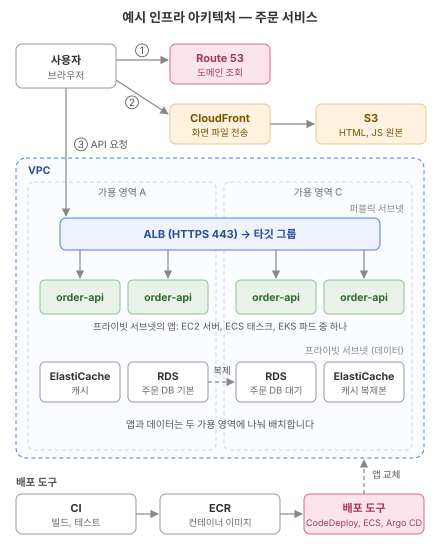
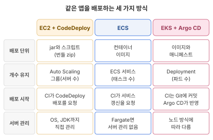
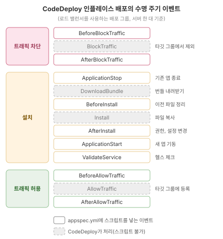
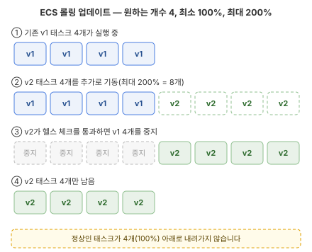
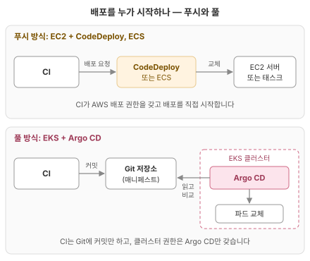
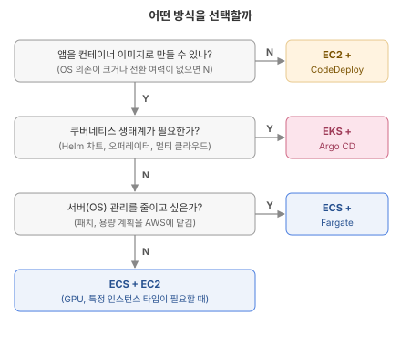

import AnatomyEmbed from '@site/src/components/AnatomyEmbed';

<!-- truncate -->

AWS에서 Spring Boot 서버 하나를 배포한다고 해 보겠습니다. 팀에 따라 "EC2에 CodeDeploy로 올린다", "ECS로 올린다", "EKS에 Argo CD로 올린다"처럼 서로 다른 답이 나옵니다. 세 방식 모두 결과적으로는 새 버전이 서버에서 실행되지만, **무엇을 배포하는지**, **누가 실행 개수를 유지하는지**, **누가 배포를 시작하는지**가 다릅니다. 이 글은 같은 주문 API(`order-api`)를 세 방식으로 배포한다고 가정하고 차이를 비교합니다.

<mark>EC2 + CodeDeploy는 **서버에 새 파일을 설치**하는 방식이고, ECS와 EKS는 **컨테이너 이미지를 정해진 개수만큼 실행**하는 방식입니다. EKS + Argo CD는 여기에 더해 **Git에 적은 상태로 클러스터를 맞추는** 방식입니다.</mark>

이 글은 다음 순서로 살펴봅니다.

1. **용어와 예시 인프라**: 요청이 브라우저에서 서버까지 어떻게 도착하는지 먼저 봅니다. 세 방식 모두 이 구성 위에서 동작합니다.
2. **세 가지 실행 방식**: EC2 + CodeDeploy, ECS, EKS + Argo CD가 앱을 어디서 어떻게 실행하는지 비교합니다.
3. **배포 유형**: 인플레이스, 롤링, 블루/그린, 카나리, 리니어가 새 버전으로 교체하는 순서를 봅니다.
4. **배포를 시작하는 주체**: CI가 배포를 요청하는 푸시 방식과, Argo CD가 Git을 감지하는 풀 방식을 비교합니다.
5. **실무 예시와 선택 기준**: 같은 버전을 세 방식으로 배포하는 명령과, 어떤 방식을 선택할지 정리합니다.

## 먼저 알아 둘 용어

세 방식을 비교하기 전에 자주 나오는 용어 세 가지를 정리합니다.

- **컨테이너 이미지**: 애플리케이션과 실행에 필요한 파일을 한 파일로 만든 것입니다. 이미지는 **ECR(Elastic Container Registry)** 같은 이미지 저장소에 올려 두고, 서버가 내려받아 실행합니다.
- **오케스트레이터**: 컨테이너를 어느 서버에서 몇 개 실행할지 정하고, 종료된 컨테이너를 다시 기동하는 시스템입니다. ECS와 쿠버네티스가 여기에 해당합니다.
- **CD(지속적 배포) 도구**: 빌드된 결과물을 실행 환경에 반영하는 도구입니다. CodeDeploy와 Argo CD가 여기에 해당합니다.

## 예시 인프라 — 요청이 서버에 도착하기까지

세 방식은 서버를 실행하고 교체하는 방법이 다를 뿐, 앞단의 구성은 거의 같습니다. 이 글에서는 아래 구성을 예시로 사용합니다.

<details>
<summary>SVG 코드</summary>

```svg
<svg xmlns="http://www.w3.org/2000/svg" width="440" height="560" viewBox="0 0 440 560" font-family="-apple-system, 'Segoe UI', 'Noto Sans KR', sans-serif">
<defs><marker id="ah" viewBox="0 0 10 10" refX="9" refY="5" markerWidth="7" markerHeight="7" orient="auto-start-reverse"><path d="M0,0 L10,5 L0,10 z" fill="#888"/></marker></defs>
<rect x="0" y="0" width="440" height="560" fill="#FFFFFF"/>
<text x="220" y="22" font-size="13" fill="#333" text-anchor="middle" font-weight="bold">예시 인프라 아키텍처 — 주문 서비스</text>
<rect x="16" y="44" width="100" height="44" rx="6" fill="#FFFFFF" stroke="#999"/>
<text x="66" y="64" font-size="11" fill="#333" text-anchor="middle" font-weight="bold">사용자</text>
<text x="66" y="79" font-size="10" fill="#666" text-anchor="middle">브라우저</text>
<rect x="170" y="44" width="100" height="40" rx="6" fill="#FCE4EC" stroke="#D06A86"/>
<text x="220" y="62" font-size="11" fill="#9E3A57" text-anchor="middle" font-weight="bold">Route 53</text>
<text x="220" y="76" font-size="9.5" fill="#9E3A57" text-anchor="middle">도메인 조회</text>
<line x1="116" y1="60" x2="168" y2="60" stroke="#888" stroke-width="1.2" marker-end="url(#ah)"/>
<text x="142" y="54" font-size="10" fill="#555" text-anchor="middle">①</text>
<rect x="170" y="104" width="100" height="40" rx="6" fill="#FFF3E0" stroke="#E8C98F"/>
<text x="220" y="122" font-size="11" fill="#7A5200" text-anchor="middle" font-weight="bold">CloudFront</text>
<text x="220" y="136" font-size="9.5" fill="#7A5200" text-anchor="middle">화면 파일 전송</text>
<rect x="316" y="104" width="110" height="40" rx="6" fill="#FFF3E0" stroke="#E8C98F"/>
<text x="371" y="122" font-size="11" fill="#7A5200" text-anchor="middle" font-weight="bold">S3</text>
<text x="371" y="136" font-size="9.5" fill="#7A5200" text-anchor="middle">HTML, JS 원본</text>
<line x1="116" y1="80" x2="168" y2="114" stroke="#888" stroke-width="1.2" marker-end="url(#ah)"/>
<text x="132" y="106" font-size="10" fill="#555" text-anchor="middle">②</text>
<line x1="270" y1="124" x2="314" y2="124" stroke="#888" stroke-width="1.2" marker-end="url(#ah)"/>
<rect x="16" y="158" width="408" height="300" rx="10" fill="#FAFCFF" stroke="#4C7FE0" stroke-dasharray="4 3"/>
<text x="28" y="174" font-size="10.5" fill="#26508F" text-anchor="start" font-weight="bold">VPC</text>
<rect x="28" y="182" width="188" height="268" rx="6" fill="none" stroke="#C9D6EA" stroke-dasharray="4 3"/>
<rect x="224" y="182" width="188" height="268" rx="6" fill="none" stroke="#C9D6EA" stroke-dasharray="4 3"/>
<text x="122" y="196" font-size="10" fill="#666" text-anchor="middle">가용 영역 A</text>
<text x="318" y="196" font-size="10" fill="#666" text-anchor="middle">가용 영역 C</text>
<text x="404" y="212" font-size="9.5" fill="#888" text-anchor="end">퍼블릭 서브넷</text>
<rect x="60" y="218" width="320" height="32" rx="6" fill="#EEF3FB" stroke="#4C7FE0"/>
<text x="220" y="238" font-size="11" fill="#26508F" text-anchor="middle" font-weight="bold">ALB (HTTPS 443) → 타깃 그룹</text>
<line x1="66" y1="88" x2="66" y2="216" stroke="#888" stroke-width="1.2" marker-end="url(#ah)"/>
<text x="74" y="148" font-size="10" fill="#555" text-anchor="start">③ API 요청</text>
<rect x="40" y="280" width="80" height="34" rx="5" fill="#E9F2E9" stroke="#8FBF8F"/>
<text x="80" y="301" font-size="10.5" fill="#2E6B2E" text-anchor="middle" font-weight="bold">order-api</text>
<line x1="80" y1="250" x2="80" y2="278" stroke="#888" stroke-width="1.2" marker-end="url(#ah)"/>
<rect x="128" y="280" width="80" height="34" rx="5" fill="#E9F2E9" stroke="#8FBF8F"/>
<text x="168" y="301" font-size="10.5" fill="#2E6B2E" text-anchor="middle" font-weight="bold">order-api</text>
<line x1="168" y1="250" x2="168" y2="278" stroke="#888" stroke-width="1.2" marker-end="url(#ah)"/>
<rect x="236" y="280" width="80" height="34" rx="5" fill="#E9F2E9" stroke="#8FBF8F"/>
<text x="276" y="301" font-size="10.5" fill="#2E6B2E" text-anchor="middle" font-weight="bold">order-api</text>
<line x1="276" y1="250" x2="276" y2="278" stroke="#888" stroke-width="1.2" marker-end="url(#ah)"/>
<rect x="324" y="280" width="80" height="34" rx="5" fill="#E9F2E9" stroke="#8FBF8F"/>
<text x="364" y="301" font-size="10.5" fill="#2E6B2E" text-anchor="middle" font-weight="bold">order-api</text>
<line x1="364" y1="250" x2="364" y2="278" stroke="#888" stroke-width="1.2" marker-end="url(#ah)"/>
<text x="220" y="330" font-size="9.5" fill="#555" text-anchor="middle">프라이빗 서브넷의 앱: EC2 서버, ECS 태스크, EKS 파드 중 하나</text>
<text x="404" y="354" font-size="9.5" fill="#888" text-anchor="end">프라이빗 서브넷 (데이터)</text>
<rect x="40" y="362" width="80" height="40" rx="5" fill="#FFFFFF" stroke="#999"/>
<text x="80" y="380" font-size="10.5" fill="#333" text-anchor="middle" font-weight="bold">ElastiCache</text>
<text x="80" y="394" font-size="9.5" fill="#666" text-anchor="middle">캐시</text>
<rect x="128" y="362" width="80" height="40" rx="5" fill="#FFFFFF" stroke="#999"/>
<text x="168" y="380" font-size="10.5" fill="#333" text-anchor="middle" font-weight="bold">RDS</text>
<text x="168" y="394" font-size="9.5" fill="#666" text-anchor="middle">주문 DB 기본</text>
<rect x="236" y="362" width="80" height="40" rx="5" fill="#FFFFFF" stroke="#999"/>
<text x="276" y="380" font-size="10.5" fill="#333" text-anchor="middle" font-weight="bold">RDS</text>
<text x="276" y="394" font-size="9.5" fill="#666" text-anchor="middle">주문 DB 대기</text>
<rect x="324" y="362" width="80" height="40" rx="5" fill="#FFFFFF" stroke="#999"/>
<text x="364" y="380" font-size="10.5" fill="#333" text-anchor="middle" font-weight="bold">ElastiCache</text>
<text x="364" y="394" font-size="9.5" fill="#666" text-anchor="middle">캐시 복제본</text>
<line x1="208" y1="382" x2="234" y2="382" stroke="#888" stroke-width="1.2" stroke-dasharray="4 3" marker-end="url(#ah)"/>
<text x="222" y="374" font-size="9.5" fill="#555" text-anchor="middle">복제</text>
<text x="220" y="428" font-size="10" fill="#555" text-anchor="middle">앱과 데이터는 두 가용 영역에 나눠 배치합니다</text>
<text x="16" y="486" font-size="10.5" fill="#555" text-anchor="start" font-weight="bold">배포 도구</text>
<rect x="16" y="494" width="120" height="40" rx="6" fill="#FFFFFF" stroke="#999"/>
<text x="76" y="512" font-size="11" fill="#333" text-anchor="middle" font-weight="bold">CI</text>
<text x="76" y="526" font-size="9.5" fill="#666" text-anchor="middle">빌드, 테스트</text>
<rect x="160" y="494" width="120" height="40" rx="6" fill="#FFFFFF" stroke="#999"/>
<text x="220" y="512" font-size="11" fill="#333" text-anchor="middle" font-weight="bold">ECR</text>
<text x="220" y="526" font-size="9.5" fill="#666" text-anchor="middle">컨테이너 이미지</text>
<rect x="304" y="494" width="120" height="40" rx="6" fill="#FCE4EC" stroke="#D06A86"/>
<text x="364" y="512" font-size="11" fill="#9E3A57" text-anchor="middle" font-weight="bold">배포 도구</text>
<text x="364" y="526" font-size="9" fill="#9E3A57" text-anchor="middle">CodeDeploy, ECS, Argo CD</text>
<line x1="136" y1="514" x2="158" y2="514" stroke="#888" stroke-width="1.2" marker-end="url(#ah)"/>
<line x1="280" y1="514" x2="302" y2="514" stroke="#888" stroke-width="1.2" marker-end="url(#ah)"/>
<line x1="364" y1="494" x2="364" y2="460" stroke="#888" stroke-width="1.2" stroke-dasharray="4 3" marker-end="url(#ah)"/>
<text x="372" y="478" font-size="9.5" fill="#555" text-anchor="start">앱 교체</text>
</svg>
```

</details>

<figure style={{textAlign: 'center', margin: '1.5rem 0'}}>
  
</figure>

사용자가 화면을 열고 주문을 조회할 때 요청이 거치는 순서대로 구성 요소를 살펴봅니다. 각 설명 아래 장면에서 캡션을 누르면 그 순간으로 이동하고, 장면 아래 '다시 재생' 버튼을 누르면 처음부터 다시 재생됩니다.

### ① 프론트 받기 — Route 53, CloudFront, S3

- **Route 53**: 도메인(`shop.example.com`, `api.example.com`)을 IP 주소로 알려 주는 DNS 서비스입니다.
- **CloudFront와 S3**: 프론트엔드의 HTML, JS 파일은 S3에 올려 두고, CloudFront(CDN)가 사용자와 가까운 위치에서 전송합니다. CloudFront 캐시에 없는 파일만 S3에서 가져옵니다. 프론트 파일은 서버 배포 방식과 관계없이 따로 배포합니다.

<AnatomyEmbed name="deploy-flow" query="steps=1" title="브라우저가 Route 53에서 도메인을 조회하고 CloudFront와 S3에서 HTML, JS를 받아 화면을 표시하는 ① 단계 장면" />

### ② API 요청과 ALB

화면이 뜨면 프론트 JS가 API 도메인으로 주문 조회를 요청합니다. **ALB(Application Load Balancer)** 는 이 요청을 받아 인증서로 HTTPS를 처리하고, 리스너 규칙(예: `/orders`)에 따라 요청을 **타깃 그룹**으로 보냅니다.

<AnatomyEmbed name="deploy-flow" query="steps=2" title="API 요청이 Route 53을 거쳐 ALB에 도착하고, ALB가 HTTPS를 처리한 뒤 리스너 규칙에 따라 order-api 타깃 그룹으로 보내는 ② 단계 장면" />

### ③ 타깃 그룹과 헬스 체크

타깃 그룹은 요청을 받을 대상의 목록입니다. ALB는 헬스 체크를 통과한 대상에만 요청을 보냅니다. 대상은 방식마다 다릅니다.

- **EC2 + CodeDeploy**: EC2 서버가 대상입니다.
- **ECS**: 서비스가 태스크를 타깃 그룹에 등록합니다.
- **EKS**: AWS Load Balancer Controller가 파드를 타깃 그룹에 등록합니다.

배포에서 중요한 부분이 이 타깃 그룹입니다. 어느 방식이든 새 버전을 타깃 그룹에 등록하고 기존 버전을 등록 해제하는 순서로 무중단 배포가 이루어집니다. 등록 해제된 대상은 바로 종료되지 않고, 진행 중인 요청을 마칠 때까지 기다립니다(등록 해제 지연, 기본 300초).

<AnatomyEmbed name="deploy-flow" query="steps=3" title="타깃 그룹이 헬스 체크에 실패한 대상을 제외하고 나머지 대상에만 요청을 나누며, 대상이 EC2 서버, ECS 태스크, EKS 파드로 달라지는 ③ 단계 장면" />

### ④ 데이터와 응답 — RDS, ElastiCache

앱과 데이터베이스는 인터넷에서 직접 접근할 수 없는 프라이빗 서브넷에 배치하고, 두 가용 영역(AZ)에 나눠 한 AZ에 장애가 나도 서비스가 유지되게 합니다. 주문 데이터는 **RDS**(MySQL 등)에 저장하고, 자주 조회하는 데이터는 **ElastiCache**(Redis)에 캐시합니다. 앱은 먼저 캐시를 조회하고, 없으면 RDS에서 조회한 뒤 캐시에 저장합니다. 응답은 ALB를 거쳐 브라우저로 돌아갑니다.

<AnatomyEmbed name="deploy-flow" query="steps=4" title="앱이 ElastiCache를 먼저 조회하고 없으면 RDS에서 조회해 캐시에 저장한 뒤, 응답이 ALB를 거쳐 브라우저로 돌아가는 ④ 단계 장면" />

<mark>세 방식 모두 **ALB의 타깃 그룹에 새 버전을 등록하고 기존 버전을 등록 해제**하는 방식으로 요청이 끊기지 않게 교체합니다.</mark>

## 세 가지 실행 방식 — 앱을 어디서 어떻게 실행하나

같은 order-api를 세 방식이 각각 어떻게 실행하는지 먼저 한 장으로 보고, 하나씩 살펴봅니다.

<details>
<summary>SVG 코드</summary>

```svg
<svg xmlns="http://www.w3.org/2000/svg" width="440" height="290" viewBox="0 0 440 290" font-family="-apple-system, 'Segoe UI', 'Noto Sans KR', sans-serif">
<defs><marker id="ah" viewBox="0 0 10 10" refX="9" refY="5" markerWidth="7" markerHeight="7" orient="auto-start-reverse"><path d="M0,0 L10,5 L0,10 z" fill="#888"/></marker></defs>
<rect x="0" y="0" width="440" height="290" fill="#FFFFFF"/>
<text x="220" y="22" font-size="13" fill="#333" text-anchor="middle" font-weight="bold">같은 앱을 배포하는 세 가지 방식</text>
<rect x="76" y="40" width="116" height="34" rx="6" fill="#FFF3E0" stroke="#E8C98F"/>
<text x="134.0" y="62" font-size="11.5" fill="#7A5200" text-anchor="middle" font-weight="bold">EC2 + CodeDeploy</text>
<rect x="196" y="40" width="116" height="34" rx="6" fill="#EEF3FB" stroke="#4C7FE0"/>
<text x="254.0" y="62" font-size="11.5" fill="#26508F" text-anchor="middle" font-weight="bold">ECS</text>
<rect x="316" y="40" width="116" height="34" rx="6" fill="#FCE4EC" stroke="#D06A86"/>
<text x="374.0" y="62" font-size="11.5" fill="#9E3A57" text-anchor="middle" font-weight="bold">EKS + Argo CD</text>
<rect x="8" y="82" width="64" height="46" rx="4" fill="#F7F7F7" stroke="#DDDDDD"/>
<text x="40" y="109" font-size="10.5" fill="#555" text-anchor="middle" font-weight="bold">배포 단위</text>
<rect x="76" y="82" width="116" height="46" rx="4" fill="#FFFFFF" stroke="#E8C98F"/>
<text x="134.0" y="102" font-size="10.5" fill="#333" text-anchor="middle">jar와 스크립트</text>
<text x="134.0" y="117" font-size="10.5" fill="#333" text-anchor="middle">(번들 zip)</text>
<rect x="196" y="82" width="116" height="46" rx="4" fill="#FFFFFF" stroke="#4C7FE0"/>
<text x="254.0" y="102" font-size="10.5" fill="#333" text-anchor="middle">컨테이너</text>
<text x="254.0" y="117" font-size="10.5" fill="#333" text-anchor="middle">이미지</text>
<rect x="316" y="82" width="116" height="46" rx="4" fill="#FFFFFF" stroke="#D06A86"/>
<text x="374.0" y="102" font-size="10.5" fill="#333" text-anchor="middle">이미지와</text>
<text x="374.0" y="117" font-size="10.5" fill="#333" text-anchor="middle">매니페스트</text>
<rect x="8" y="132" width="64" height="46" rx="4" fill="#F7F7F7" stroke="#DDDDDD"/>
<text x="40" y="159" font-size="10.5" fill="#555" text-anchor="middle" font-weight="bold">개수 유지</text>
<rect x="76" y="132" width="116" height="46" rx="4" fill="#FFFFFF" stroke="#E8C98F"/>
<text x="134.0" y="152" font-size="10.5" fill="#333" text-anchor="middle">Auto Scaling</text>
<text x="134.0" y="167" font-size="10.5" fill="#333" text-anchor="middle">그룹(서버 수)</text>
<rect x="196" y="132" width="116" height="46" rx="4" fill="#FFFFFF" stroke="#4C7FE0"/>
<text x="254.0" y="152" font-size="10.5" fill="#333" text-anchor="middle">ECS 서비스</text>
<text x="254.0" y="167" font-size="10.5" fill="#333" text-anchor="middle">(태스크 수)</text>
<rect x="316" y="132" width="116" height="46" rx="4" fill="#FFFFFF" stroke="#D06A86"/>
<text x="374.0" y="152" font-size="10.5" fill="#333" text-anchor="middle">Deployment</text>
<text x="374.0" y="167" font-size="10.5" fill="#333" text-anchor="middle">(파드 수)</text>
<rect x="8" y="182" width="64" height="46" rx="4" fill="#F7F7F7" stroke="#DDDDDD"/>
<text x="40" y="209" font-size="10.5" fill="#555" text-anchor="middle" font-weight="bold">배포 시작</text>
<rect x="76" y="182" width="116" height="46" rx="4" fill="#FFFFFF" stroke="#E8C98F"/>
<text x="134.0" y="202" font-size="10.5" fill="#333" text-anchor="middle">CI가 CodeDeploy</text>
<text x="134.0" y="217" font-size="10.5" fill="#333" text-anchor="middle">배포를 요청</text>
<rect x="196" y="182" width="116" height="46" rx="4" fill="#FFFFFF" stroke="#4C7FE0"/>
<text x="254.0" y="202" font-size="10.5" fill="#333" text-anchor="middle">CI가 서비스</text>
<text x="254.0" y="217" font-size="10.5" fill="#333" text-anchor="middle">갱신을 요청</text>
<rect x="316" y="182" width="116" height="46" rx="4" fill="#FFFFFF" stroke="#D06A86"/>
<text x="374.0" y="202" font-size="10.5" fill="#333" text-anchor="middle">CI는 Git에 커밋</text>
<text x="374.0" y="217" font-size="10.5" fill="#333" text-anchor="middle">Argo CD가 반영</text>
<rect x="8" y="232" width="64" height="46" rx="4" fill="#F7F7F7" stroke="#DDDDDD"/>
<text x="40" y="259" font-size="10.5" fill="#555" text-anchor="middle" font-weight="bold">서버 관리</text>
<rect x="76" y="232" width="116" height="46" rx="4" fill="#FFFFFF" stroke="#E8C98F"/>
<text x="134.0" y="252" font-size="10.5" fill="#333" text-anchor="middle">OS, JDK까지</text>
<text x="134.0" y="267" font-size="10.5" fill="#333" text-anchor="middle">직접 관리</text>
<rect x="196" y="232" width="116" height="46" rx="4" fill="#FFFFFF" stroke="#4C7FE0"/>
<text x="254.0" y="252" font-size="10.5" fill="#333" text-anchor="middle">Fargate면</text>
<text x="254.0" y="267" font-size="10.5" fill="#333" text-anchor="middle">서버 관리 없음</text>
<rect x="316" y="232" width="116" height="46" rx="4" fill="#FFFFFF" stroke="#D06A86"/>
<text x="374.0" y="252" font-size="10.5" fill="#333" text-anchor="middle">노드 방식에</text>
<text x="374.0" y="267" font-size="10.5" fill="#333" text-anchor="middle">따라 다름</text>
</svg>
```

</details>

<figure style={{textAlign: 'center', margin: '1.5rem 0'}}>
  
</figure>

- **배포 단위**: EC2 + CodeDeploy는 jar 파일과 설치 스크립트를 zip 파일 하나로 만든 **번들**을 배포합니다. ECS와 EKS는 애플리케이션과 실행 환경(JDK, 라이브러리)을 함께 넣은 **컨테이너 이미지**를 배포합니다.
- **개수 유지**: 서버나 컨테이너가 한 대 종료됐을 때 새로 기동해 개수를 유지하는 주체입니다. EC2는 Auto Scaling 그룹이 서버 수를, ECS는 서비스가 태스크 수를, 쿠버네티스는 Deployment가 파드 수를 유지합니다.
- **배포 시작**: CodeDeploy와 ECS는 CI가 AWS API를 호출해 배포를 시작합니다. Argo CD를 사용하면 CI는 Git에 커밋만 하고, 클러스터 안의 Argo CD가 변경을 반영합니다.
- **서버 관리**: EC2는 OS 패치와 JDK 설치까지 직접 합니다. ECS를 Fargate로 실행하면 관리할 서버가 없습니다.

### EC2 + CodeDeploy — 서버에 새 버전을 설치하는 방식

**EC2(Elastic Compute Cloud)** 는 AWS의 가상 서버이고, **CodeDeploy**는 서버에 애플리케이션 파일을 설치하는 배포 서비스입니다. 구성 요소는 다음과 같습니다.

- **애플리케이션과 배포 그룹**: CodeDeploy에 "어떤 앱을 어떤 서버 그룹에 배포할지"를 등록합니다. 배포 그룹은 태그나 Auto Scaling 그룹으로 대상 서버를 지정합니다.
- **리비전(revision)**: 배포할 번들입니다. jar 파일, 스크립트, `appspec.yml`을 zip으로 만들어 S3, GitHub, Bitbucket 중 한 곳에 업로드합니다.
- **CodeDeploy 에이전트**: 각 EC2 서버에 설치하는 프로그램입니다. 배포가 시작되면 에이전트가 번들을 내려받고 스크립트를 실행합니다. [에이전트 문서](https://docs.aws.amazon.com/codedeploy/latest/userguide/codedeploy-agent.html)에 다음과 같이 있습니다.

> The CodeDeploy agent is required only if you deploy to an EC2/On-Premises compute platform.

즉 에이전트는 서버에 직접 설치하는 배포에만 필요하고, 뒤에서 볼 [ECS + CodeDeploy 연동](#블루그린--검증한-뒤-한-번에-전환) 배포에는 필요하지 않습니다.

#### appspec.yml — 어떤 파일을 어디에 복사하고 언제 무엇을 실행할지

`appspec.yml`은 번들 안에 넣는 배포 명세입니다. 파일을 복사할 위치와, 배포 단계마다 실행할 스크립트를 적습니다.

```yaml
version: 0.0
os: linux
files:
  - source: order-api.jar
    destination: /opt/order-api
hooks:
  ApplicationStop:
    - location: scripts/stop.sh        # 기존 프로세스 종료
      timeout: 60
  AfterInstall:
    - location: scripts/configure.sh   # 권한, 설정 파일 변경
  ApplicationStart:
    - location: scripts/start.sh       # systemctl start order-api
  ValidateService:
    - location: scripts/health.sh      # /actuator/health가 UP인지 확인
      timeout: 120
```

`hooks`의 이름은 CodeDeploy가 정한 **수명 주기 이벤트**입니다. 배포 그룹이 로드 밸런서를 사용하면, 서버 한 대에서 아래 순서로 진행됩니다.

<details>
<summary>SVG 코드</summary>

```svg
<svg xmlns="http://www.w3.org/2000/svg" width="440" height="470" viewBox="0 0 440 470" font-family="-apple-system, 'Segoe UI', 'Noto Sans KR', sans-serif">
<defs><marker id="ah" viewBox="0 0 10 10" refX="9" refY="5" markerWidth="7" markerHeight="7" orient="auto-start-reverse"><path d="M0,0 L10,5 L0,10 z" fill="#888"/></marker></defs>
<rect x="0" y="0" width="440" height="470" fill="#FFFFFF"/>
<text x="220" y="22" font-size="13" fill="#333" text-anchor="middle" font-weight="bold">CodeDeploy 인플레이스 배포의 수명 주기 이벤트</text>
<text x="220" y="40" font-size="10" fill="#888" text-anchor="middle">(로드 밸런서를 사용하는 배포 그룹, 서버 한 대 기준)</text>
<rect x="12" y="54" width="84" height="74" rx="6" fill="#FCE4EC" stroke="#D06A86"/>
<text x="54" y="95.0" font-size="11" fill="#9E3A57" text-anchor="middle" font-weight="bold">트래픽 차단</text>
<rect x="106" y="54" width="190" height="22" rx="4" fill="#FFFFFF" stroke="#D06A86"/>
<text x="201" y="69" font-size="10.5" fill="#333" text-anchor="middle">BeforeBlockTraffic</text>
<rect x="106" y="80" width="190" height="22" rx="4" fill="#EEEEEE" stroke="#BBBBBB" stroke-dasharray="4 3"/>
<text x="201" y="95" font-size="10.5" fill="#777" text-anchor="middle">BlockTraffic</text>
<text x="306" y="95" font-size="10" fill="#555" text-anchor="start">타깃 그룹에서 제외</text>
<rect x="106" y="106" width="190" height="22" rx="4" fill="#FFFFFF" stroke="#D06A86"/>
<text x="201" y="121" font-size="10.5" fill="#333" text-anchor="middle">AfterBlockTraffic</text>
<rect x="12" y="142" width="84" height="178" rx="6" fill="#FFF3E0" stroke="#E8C98F"/>
<text x="54" y="235.0" font-size="11" fill="#7A5200" text-anchor="middle" font-weight="bold">설치</text>
<rect x="106" y="142" width="190" height="22" rx="4" fill="#FFFFFF" stroke="#E8C98F"/>
<text x="201" y="157" font-size="10.5" fill="#333" text-anchor="middle">ApplicationStop</text>
<text x="306" y="157" font-size="10" fill="#555" text-anchor="start">기존 앱 종료</text>
<rect x="106" y="168" width="190" height="22" rx="4" fill="#EEEEEE" stroke="#BBBBBB" stroke-dasharray="4 3"/>
<text x="201" y="183" font-size="10.5" fill="#777" text-anchor="middle">DownloadBundle</text>
<text x="306" y="183" font-size="10" fill="#555" text-anchor="start">번들 내려받기</text>
<rect x="106" y="194" width="190" height="22" rx="4" fill="#FFFFFF" stroke="#E8C98F"/>
<text x="201" y="209" font-size="10.5" fill="#333" text-anchor="middle">BeforeInstall</text>
<text x="306" y="209" font-size="10" fill="#555" text-anchor="start">이전 파일 정리</text>
<rect x="106" y="220" width="190" height="22" rx="4" fill="#EEEEEE" stroke="#BBBBBB" stroke-dasharray="4 3"/>
<text x="201" y="235" font-size="10.5" fill="#777" text-anchor="middle">Install</text>
<text x="306" y="235" font-size="10" fill="#555" text-anchor="start">파일 복사</text>
<rect x="106" y="246" width="190" height="22" rx="4" fill="#FFFFFF" stroke="#E8C98F"/>
<text x="201" y="261" font-size="10.5" fill="#333" text-anchor="middle">AfterInstall</text>
<text x="306" y="261" font-size="10" fill="#555" text-anchor="start">권한, 설정 변경</text>
<rect x="106" y="272" width="190" height="22" rx="4" fill="#FFFFFF" stroke="#E8C98F"/>
<text x="201" y="287" font-size="10.5" fill="#333" text-anchor="middle">ApplicationStart</text>
<text x="306" y="287" font-size="10" fill="#555" text-anchor="start">새 앱 기동</text>
<rect x="106" y="298" width="190" height="22" rx="4" fill="#FFFFFF" stroke="#E8C98F"/>
<text x="201" y="313" font-size="10.5" fill="#333" text-anchor="middle">ValidateService</text>
<text x="306" y="313" font-size="10" fill="#555" text-anchor="start">헬스 체크</text>
<rect x="12" y="334" width="84" height="74" rx="6" fill="#E9F2E9" stroke="#8FBF8F"/>
<text x="54" y="375.0" font-size="11" fill="#2E6B2E" text-anchor="middle" font-weight="bold">트래픽 허용</text>
<rect x="106" y="334" width="190" height="22" rx="4" fill="#FFFFFF" stroke="#8FBF8F"/>
<text x="201" y="349" font-size="10.5" fill="#333" text-anchor="middle">BeforeAllowTraffic</text>
<rect x="106" y="360" width="190" height="22" rx="4" fill="#EEEEEE" stroke="#BBBBBB" stroke-dasharray="4 3"/>
<text x="201" y="375" font-size="10.5" fill="#777" text-anchor="middle">AllowTraffic</text>
<text x="306" y="375" font-size="10" fill="#555" text-anchor="start">타깃 그룹에 등록</text>
<rect x="106" y="386" width="190" height="22" rx="4" fill="#FFFFFF" stroke="#8FBF8F"/>
<text x="201" y="401" font-size="10.5" fill="#333" text-anchor="middle">AfterAllowTraffic</text>
<rect x="106" y="426" width="22" height="14" rx="3" fill="#FFFFFF" stroke="#888"/>
<text x="134" y="437" font-size="10" fill="#555" text-anchor="start">appspec.yml에 스크립트를 넣는 이벤트</text>
<rect x="106" y="448" width="22" height="14" rx="3" fill="#EEEEEE" stroke="#BBBBBB" stroke-dasharray="4 3"/>
<text x="134" y="459" font-size="10" fill="#555" text-anchor="start">CodeDeploy가 처리(스크립트 불가)</text>
</svg>
```

</details>

<figure style={{textAlign: 'center', margin: '1.5rem 0'}}>
  
</figure>

1. **트래픽 차단**: 로드 밸런서의 타깃 그룹에서 서버를 빼서 요청이 들어오지 않게 합니다.
2. **설치**: 기존 앱을 종료하고, 번들을 내려받아 파일을 복사한 뒤 새 앱을 기동하고 헬스 체크를 합니다.
3. **트래픽 허용**: 서버를 타깃 그룹에 다시 등록합니다.

회색 점선 이벤트(`DownloadBundle`, `Install`, `BlockTraffic`, `AllowTraffic`)에는 스크립트를 넣을 수 없습니다. [수명 주기 이벤트 문서](https://docs.aws.amazon.com/codedeploy/latest/userguide/reference-appspec-file-structure-hooks.html)에 다음과 같이 있습니다.

> This event is reserved for the CodeDeploy agent and cannot be used to run scripts.

즉 파일을 내려받고 복사하는 일은 에이전트가 하고, 사용자는 그 앞뒤에 실행할 스크립트만 정합니다.

#### 이 방식이 맞는 경우와 부담

- **맞는 경우**: 컨테이너로 옮기지 않은 기존 서비스, 서버에 설치된 소프트웨어(에이전트, 라이선스 프로그램)에 의존하는 서비스입니다.
- **부담**: OS 패치, JDK 업그레이드, 에이전트 설치를 팀이 직접 합니다. 서버마다 설치 이력이 쌓여서 서버 간 환경이 달라지기 쉽고, 새 서버를 만들 때는 AMI(서버 이미지)를 따로 관리해야 합니다.

### ECS — 컨테이너를 정해진 개수만큼 유지하는 방식

**ECS(Elastic Container Service)** 는 AWS가 만든 컨테이너 오케스트레이터입니다. ECS에서는 서버에 파일을 설치하지 않고, **이미지를 지정해 컨테이너를 몇 개 실행할지**를 선언합니다.

- **클러스터**: 태스크가 실행되는 공간입니다.
- **태스크 정의(task definition)**: 실행 설계도입니다. 이미지, CPU와 메모리, 포트, 환경 변수를 적고, 고칠 때마다 새 리비전(`order-api:12`, `order-api:13`)이 생깁니다.
- **태스크(task)**: 태스크 정의로 실행한 컨테이너(들)입니다.
- **서비스(service)**: 태스크를 원하는 개수만큼 계속 실행합니다. [서비스 문서](https://docs.aws.amazon.com/AmazonECS/latest/developerguide/ecs_services.html)에 다음과 같이 있습니다.

> The service scheduler also replaces tasks determined to be unhealthy after a container health check or a load balancer target group health check fails.

즉 태스크가 헬스 체크에 실패하면 서비스가 그 태스크를 새 태스크로 교체합니다. 서비스는 로드 밸런서의 타깃 그룹에 태스크를 등록하고 해제하는 일도 합니다.

태스크 정의는 JSON으로 작성합니다. 아래는 핵심 항목만 남긴 예시입니다.

```json
{
  "family": "order-api",
  "cpu": "512",
  "memory": "1024",
  "requiresCompatibilities": ["FARGATE"],
  "containerDefinitions": [
    {
      "name": "order-api",
      "image": "123456789012.dkr.ecr.ap-northeast-2.amazonaws.com/order-api:1.4.0",
      "portMappings": [{ "containerPort": 8080 }],
      "environment": [{ "name": "SPRING_PROFILES_ACTIVE", "value": "prod" }]
    }
  ]
}
```

#### 태스크가 실행되는 곳 — Fargate, EC2, Managed Instances

ECS는 태스크를 어디서 실행할지(용량 옵션)를 선택할 수 있습니다.

| 용량 옵션 | 서버 관리 | 맞는 경우 |
|---|---|---|
| **Fargate** | 서버가 보이지 않습니다. 태스크가 요청한 vCPU와 메모리만큼 과금됩니다 | 서버 관리 없이 운영하려는 대부분의 웹 서비스 |
| **EC2** | 클러스터에 등록한 EC2 서버를 팀이 관리합니다 | GPU, 특정 인스턴스 타입, 서버 단위 할인을 써야 할 때 |
| **Managed Instances** | EC2 인스턴스를 쓰되 패치와 교체를 AWS가 관리합니다 | EC2 인스턴스 타입이 필요하지만 서버 관리는 줄이려 할 때 |
| **ECS Anywhere** | 온프레미스 서버를 등록해 사용합니다 | 자체 데이터센터의 서버도 같은 방식으로 운영할 때 |

Fargate 요금은 [Fargate 요금 페이지](https://aws.amazon.com/fargate/pricing/)에 따르면 초 단위로 계산되고 최소 1분이 청구됩니다. 태스크를 자주 실행하고 종료하는 배치에서도 실행한 시간만큼만 내면 됩니다.

#### 이 방식이 맞는 경우와 부담

- **맞는 경우**: AWS 안에서 웹 서비스와 배치를 운영하는 팀입니다. 클러스터 자체에 요금이 없고, Fargate를 사용하면 서버 관리도 없습니다.
- **부담**: AWS 전용이라 다른 클라우드나 온프레미스로 옮기려면 태스크 정의와 배포 설정을 다시 작성해야 합니다. Helm 차트나 쿠버네티스 오퍼레이터 같은 쿠버네티스 생태계 도구는 사용할 수 없습니다.

### EKS + Argo CD — Git에 적은 상태로 클러스터를 맞추는 방식

**EKS(Elastic Kubernetes Service)** 는 AWS가 운영하는 쿠버네티스입니다. 쿠버네티스는 ECS와 같은 컨테이너 오케스트레이터이지만, AWS 전용이 아닌 오픈소스 표준이라 다른 클라우드나 온프레미스에서도 같은 매니페스트(YAML)로 운영할 수 있습니다.

- **EKS가 관리하는 범위**: 쿠버네티스의 컨트롤 플레인(API 서버, 스케줄러, etcd)을 AWS가 운영합니다. 파드가 실행될 노드는 관리형 노드 그룹, Fargate, EKS Auto Mode 중에서 선택하며, Auto Mode를 사용하면 노드 관리까지 AWS가 맡습니다.
- **비용**: [EKS 요금 페이지](https://aws.amazon.com/eks/pricing/)에 따르면 표준 지원 버전 기준으로 클러스터마다 시간당 0.10달러가 노드 비용과 별도로 청구됩니다. ECS는 클러스터 자체에 요금이 없습니다.
- **배포 단위**: 쿠버네티스의 **Deployment**가 ECS 서비스에 해당합니다. 원하는 파드 수를 유지하고, 롤링 업데이트를 할 때는 `maxSurge`와 `maxUnavailable` 값(기본 각각 25%)으로 동시에 교체할 파드 수를 정합니다.

쿠버네티스의 기본 개념과 EKS를 실제 프로젝트에 적용한 과정은 [쿠버네티스 기본기부터 실전 적용까지](/blog/kubernetes-basics-to-gitops)에서 자세히 정리했습니다.

#### Argo CD — 클러스터 안에서 Git을 지켜보는 배포 도구

쿠버네티스에 배포할 때 CI에서 `kubectl apply`를 실행할 수도 있습니다. 이 방식은 CI가 클러스터 관리자 권한을 가져야 하고, 누군가 클러스터에서 직접 리소스를 고치면 Git의 내용과 실제 상태가 달라집니다. **Argo CD**는 이 문제를 GitOps 방식으로 해결합니다. [Argo CD 문서](https://argo-cd.readthedocs.io/en/stable/)에 다음과 같이 있습니다.

> Argo CD is implemented as a Kubernetes controller which continuously monitors running applications and compares the current, live state against the desired target state (as specified in the Git repo).

즉 Argo CD는 클러스터 안에서 실행되면서 Git에 적힌 상태와 클러스터의 실제 상태를 계속 비교합니다. 둘이 다르면 `OutOfSync`로 표시하고, 동기화(sync)하면 Git의 내용을 클러스터에 반영합니다.

- **Application**: "어느 Git 저장소의 어느 경로를 어느 클러스터, 네임스페이스에 반영할지"를 선언하는 리소스입니다.
- **자동 동기화**: `syncPolicy.automated`를 설정하면 Git이 바뀔 때 자동으로 반영합니다. 기본값에서는 클러스터를 직접 고친 변경을 되돌리지 않고, Git에서 삭제한 리소스도 클러스터에서 삭제하지 않습니다. 되돌리려면 `selfHeal: true`, 삭제하려면 `prune: true`를 켭니다.
- **카나리, 블루/그린**: Argo CD는 Git의 상태를 반영하는 도구이고, 트래픽을 단계적으로 전환하는 일은 **Argo Rollouts** 같은 별도 컨트롤러가 합니다.

```yaml
apiVersion: argoproj.io/v1alpha1
kind: Application
metadata:
  name: order-api
  namespace: argocd
spec:
  source:
    repoURL: https://github.com/example/deploy-manifests.git
    path: order-api/prod
    targetRevision: main
  destination:
    server: https://kubernetes.default.svc
    namespace: order
  syncPolicy:
    automated:
      selfHeal: true   # 클러스터를 직접 고친 변경을 Git 상태로 되돌림
      prune: true      # Git에서 삭제한 리소스를 클러스터에서도 삭제
```

#### 이 방식이 맞는 경우와 부담

- **맞는 경우**: Helm 차트, 쿠버네티스 오퍼레이터 같은 생태계 도구가 필요하거나, 여러 클라우드와 온프레미스에서 같은 매니페스트로 운영해야 하는 팀입니다.
- **부담**: 쿠버네티스와 Argo CD를 운영할 인력이 필요하고, 클러스터마다 시간당 요금이 노드 비용과 별도로 청구됩니다. [블루/그린이나 카나리](#블루그린--검증한-뒤-한-번에-전환)를 하려면 Argo Rollouts 같은 도구를 추가로 운영해야 합니다.

<mark>세 방식의 차이는 **무엇을 교체하는가**(서버 위의 파일, 태스크, 파드)와 **누가 실행 개수를 유지하는가**(Auto Scaling 그룹, ECS 서비스, 쿠버네티스 Deployment)에 있습니다.</mark>

## 배포 유형 — 새 버전으로 교체하는 방법

실행 방식과 별개로, 새 버전으로 교체하는 순서에도 여러 유형이 있습니다. 실행 방식마다 지원하는 유형은 다음과 같습니다.

| 배포 유형 | EC2 + CodeDeploy | ECS | EKS |
|---|---|---|---|
| [인플레이스](#인플레이스--기존-서버에-새-버전을-설치) | 기본 방식(서버 몇 대씩 교체) | 해당 없음 | 해당 없음 |
| [롤링 업데이트](#롤링-업데이트--새-버전을-먼저-기동하고-기존-버전을-줄이기) | 해당 없음(인플레이스가 비슷하게 동작) | 기본 방식 | Deployment의 기본 방식 |
| [블루/그린](#블루그린--검증한-뒤-한-번에-전환) | Auto Scaling 그룹을 복사해 새 서버로 전환 | ECS 자체 전략 또는 CodeDeploy 연동 | Argo Rollouts |
| [카나리](#카나리--일부만-먼저-전환), [리니어](#리니어--같은-비율씩-나눠-전환) | 해당 없음 | ECS 자체 전략 또는 CodeDeploy 연동 | Argo Rollouts(카나리 단계 설정) |

아래에서는 배포 유형마다 EC2 + CodeDeploy, ECS, EKS 순서로 각각 어떻게 하는지 설명합니다.

### 인플레이스 — 기존 서버에 새 버전을 설치

기존 서버를 그대로 사용하고 앱만 교체합니다. 서버를 새로 만들지 않아 빠르지만, 배포 중에는 처리할 수 있는 서버 수가 줄어듭니다.

#### EC2 + CodeDeploy

CodeDeploy의 기본 배포 유형입니다. 서버가 4대라면 한 번에 몇 대씩 [앞에서 본 수명 주기 과정](#appspecyml--어떤-파일을-어디에-복사하고-언제-무엇을-실행할지)(트래픽 차단, 설치, 트래픽 허용)을 거칠지를 **배포 구성**으로 정합니다. [배포 구성 문서](https://docs.aws.amazon.com/codedeploy/latest/userguide/deployment-configurations.html)의 기본 구성은 세 가지입니다.

| 배포 구성 | 동작 | 서버 4대일 때 |
|---|---|---|
| `CodeDeployDefault.OneAtATime` | 한 번에 한 대씩 배포합니다 | 3대가 계속 요청을 처리합니다 |
| `CodeDeployDefault.HalfAtATime` | 최대 절반씩 배포합니다 | 2대씩 두 번에 나눠 배포합니다 |
| `CodeDeployDefault.AllAtOnce` | 가능한 한 많은 서버에 한 번에 배포합니다 | 배포하는 동안 처리할 서버가 없을 수 있습니다 |

아래 장면에서 세 배포 구성을 버튼으로 선택해 볼 수 있습니다. 예를 들어 `OneAtATime`으로 서버 4대에 배포하면, 한 대씩 타깃 그룹에서 제외하고 설치한 뒤 다시 등록합니다. 그동안 나머지 3대가 요청을 처리합니다.

<AnatomyEmbed name="deploy-flow" query="steps=5" title="CodeDeploy가 EC2 서버 4대에 한 대씩 타깃 그룹 제외, 설치, 헬스 체크, 재등록을 반복하는 ⑤ 단계 장면" />

배포가 실패했을 때는 배포 그룹의 **자동 롤백**을 사용합니다. 배포가 실패하거나 지정한 모니터링 기준에 도달하면, CodeDeploy가 이전 리비전을 새 배포로 다시 배포합니다([롤백 문서](https://docs.aws.amazon.com/codedeploy/latest/userguide/deployments-rollback-and-redeploy.html)).

#### ECS

인플레이스 배포가 없습니다. 컨테이너는 실행 중인 것에 새 버전을 덮어쓰지 않고, 새 이미지로 새 태스크를 기동해 교체하기 때문입니다.

#### EKS

ECS와 같은 이유로 인플레이스 배포가 없습니다. 새 이미지로 새 파드를 기동해 교체합니다.

### 롤링 업데이트 — 새 버전을 먼저 기동하고 기존 버전을 줄이기

실행 중인 대상을 몇 개씩 새 버전으로 교체합니다. 새 버전을 먼저 추가로 기동하고, 정상이 확인되면 기존 버전을 줄이므로 정상 대상 수를 유지하며 교체할 수 있습니다. 모든 교체가 하나의 [타깃 그룹](#-타깃-그룹과-헬스-체크) 안에서 진행됩니다.

#### EC2 + CodeDeploy

롤링 업데이트라는 이름의 배포 유형은 없지만, `OneAtATime`이나 `HalfAtATime` [인플레이스](#인플레이스--기존-서버에-새-버전을-설치) 배포가 서버 단위로 비슷하게 동작합니다. 차이는 새 서버를 먼저 늘리지 않고, 기존 서버를 타깃 그룹에서 제외한 뒤 그 서버에 직접 설치한다는 점입니다.

#### ECS

새 태스크 정의 리비전으로 서비스를 갱신하면 기본으로 롤링 업데이트가 진행되고, 두 값으로 동시에 실행할 태스크 수를 정합니다. [DeploymentConfiguration API 문서](https://docs.aws.amazon.com/AmazonECS/latest/APIReference/API_DeploymentConfiguration.html)에 기본값이 있습니다.

> The default value for a replica service for `minimumHealthyPercent` is 100%.

> The default `maximumPercent` value for a service using the `REPLICA` service scheduler is 200%.

즉 기본값에서는 정상 태스크 수가 원하는 개수 아래로 내려가지 않고, 배포 중에는 원하는 개수의 두 배까지 태스크를 실행할 수 있습니다. 원하는 개수가 4라면 다음 순서로 진행됩니다.

<details>
<summary>SVG 코드</summary>

```svg
<svg xmlns="http://www.w3.org/2000/svg" width="440" height="356" viewBox="0 0 440 356" font-family="-apple-system, 'Segoe UI', 'Noto Sans KR', sans-serif">
<defs><marker id="ah" viewBox="0 0 10 10" refX="9" refY="5" markerWidth="7" markerHeight="7" orient="auto-start-reverse"><path d="M0,0 L10,5 L0,10 z" fill="#888"/></marker></defs>
<rect x="0" y="0" width="440" height="356" fill="#FFFFFF"/>
<text x="220" y="22" font-size="12.5" fill="#333" text-anchor="middle" font-weight="bold">ECS 롤링 업데이트 — 원하는 개수 4, 최소 100%, 최대 200%</text>
<text x="16" y="50" font-size="11" fill="#333" text-anchor="start">① 기존 v1 태스크 4개가 실행 중</text>
<rect x="20" y="60" width="45" height="32" rx="5" fill="#EEF3FB" stroke="#4C7FE0"/>
<text x="42.5" y="80" font-size="11" fill="#26508F" text-anchor="middle" font-weight="bold">v1</text>
<rect x="71" y="60" width="45" height="32" rx="5" fill="#EEF3FB" stroke="#4C7FE0"/>
<text x="93.5" y="80" font-size="11" fill="#26508F" text-anchor="middle" font-weight="bold">v1</text>
<rect x="122" y="60" width="45" height="32" rx="5" fill="#EEF3FB" stroke="#4C7FE0"/>
<text x="144.5" y="80" font-size="11" fill="#26508F" text-anchor="middle" font-weight="bold">v1</text>
<rect x="173" y="60" width="45" height="32" rx="5" fill="#EEF3FB" stroke="#4C7FE0"/>
<text x="195.5" y="80" font-size="11" fill="#26508F" text-anchor="middle" font-weight="bold">v1</text>
<text x="16" y="120" font-size="11" fill="#333" text-anchor="start">② v2 태스크 4개를 추가로 기동(최대 200% = 8개)</text>
<rect x="20" y="130" width="45" height="32" rx="5" fill="#EEF3FB" stroke="#4C7FE0"/>
<text x="42.5" y="150" font-size="11" fill="#26508F" text-anchor="middle" font-weight="bold">v1</text>
<rect x="71" y="130" width="45" height="32" rx="5" fill="#EEF3FB" stroke="#4C7FE0"/>
<text x="93.5" y="150" font-size="11" fill="#26508F" text-anchor="middle" font-weight="bold">v1</text>
<rect x="122" y="130" width="45" height="32" rx="5" fill="#EEF3FB" stroke="#4C7FE0"/>
<text x="144.5" y="150" font-size="11" fill="#26508F" text-anchor="middle" font-weight="bold">v1</text>
<rect x="173" y="130" width="45" height="32" rx="5" fill="#EEF3FB" stroke="#4C7FE0"/>
<text x="195.5" y="150" font-size="11" fill="#26508F" text-anchor="middle" font-weight="bold">v1</text>
<rect x="224" y="130" width="45" height="32" rx="5" fill="#FFFFFF" stroke="#8FBF8F" stroke-dasharray="4 3"/>
<text x="246.5" y="150" font-size="11" fill="#2E6B2E" text-anchor="middle" font-weight="bold">v2</text>
<rect x="275" y="130" width="45" height="32" rx="5" fill="#FFFFFF" stroke="#8FBF8F" stroke-dasharray="4 3"/>
<text x="297.5" y="150" font-size="11" fill="#2E6B2E" text-anchor="middle" font-weight="bold">v2</text>
<rect x="326" y="130" width="45" height="32" rx="5" fill="#FFFFFF" stroke="#8FBF8F" stroke-dasharray="4 3"/>
<text x="348.5" y="150" font-size="11" fill="#2E6B2E" text-anchor="middle" font-weight="bold">v2</text>
<rect x="377" y="130" width="45" height="32" rx="5" fill="#FFFFFF" stroke="#8FBF8F" stroke-dasharray="4 3"/>
<text x="399.5" y="150" font-size="11" fill="#2E6B2E" text-anchor="middle" font-weight="bold">v2</text>
<text x="16" y="190" font-size="11" fill="#333" text-anchor="start">③ v2가 헬스 체크를 통과하면 v1 4개를 중지</text>
<rect x="20" y="200" width="45" height="32" rx="5" fill="#F7F7F7" stroke="#BBBBBB" stroke-dasharray="4 3"/>
<text x="42.5" y="220" font-size="10.5" fill="#999" text-anchor="middle">중지</text>
<rect x="71" y="200" width="45" height="32" rx="5" fill="#F7F7F7" stroke="#BBBBBB" stroke-dasharray="4 3"/>
<text x="93.5" y="220" font-size="10.5" fill="#999" text-anchor="middle">중지</text>
<rect x="122" y="200" width="45" height="32" rx="5" fill="#F7F7F7" stroke="#BBBBBB" stroke-dasharray="4 3"/>
<text x="144.5" y="220" font-size="10.5" fill="#999" text-anchor="middle">중지</text>
<rect x="173" y="200" width="45" height="32" rx="5" fill="#F7F7F7" stroke="#BBBBBB" stroke-dasharray="4 3"/>
<text x="195.5" y="220" font-size="10.5" fill="#999" text-anchor="middle">중지</text>
<rect x="224" y="200" width="45" height="32" rx="5" fill="#E9F2E9" stroke="#8FBF8F"/>
<text x="246.5" y="220" font-size="11" fill="#2E6B2E" text-anchor="middle" font-weight="bold">v2</text>
<rect x="275" y="200" width="45" height="32" rx="5" fill="#E9F2E9" stroke="#8FBF8F"/>
<text x="297.5" y="220" font-size="11" fill="#2E6B2E" text-anchor="middle" font-weight="bold">v2</text>
<rect x="326" y="200" width="45" height="32" rx="5" fill="#E9F2E9" stroke="#8FBF8F"/>
<text x="348.5" y="220" font-size="11" fill="#2E6B2E" text-anchor="middle" font-weight="bold">v2</text>
<rect x="377" y="200" width="45" height="32" rx="5" fill="#E9F2E9" stroke="#8FBF8F"/>
<text x="399.5" y="220" font-size="11" fill="#2E6B2E" text-anchor="middle" font-weight="bold">v2</text>
<text x="16" y="260" font-size="11" fill="#333" text-anchor="start">④ v2 태스크 4개만 남음</text>
<rect x="20" y="270" width="45" height="32" rx="5" fill="#E9F2E9" stroke="#8FBF8F"/>
<text x="42.5" y="290" font-size="11" fill="#2E6B2E" text-anchor="middle" font-weight="bold">v2</text>
<rect x="71" y="270" width="45" height="32" rx="5" fill="#E9F2E9" stroke="#8FBF8F"/>
<text x="93.5" y="290" font-size="11" fill="#2E6B2E" text-anchor="middle" font-weight="bold">v2</text>
<rect x="122" y="270" width="45" height="32" rx="5" fill="#E9F2E9" stroke="#8FBF8F"/>
<text x="144.5" y="290" font-size="11" fill="#2E6B2E" text-anchor="middle" font-weight="bold">v2</text>
<rect x="173" y="270" width="45" height="32" rx="5" fill="#E9F2E9" stroke="#8FBF8F"/>
<text x="195.5" y="290" font-size="11" fill="#2E6B2E" text-anchor="middle" font-weight="bold">v2</text>
<rect x="16" y="324" width="408" height="26" rx="5" fill="#FFFBEA" stroke="#E0A000" stroke-dasharray="4 3"/>
<text x="220" y="341" font-size="10.5" fill="#5A4300" text-anchor="middle">정상인 태스크가 4개(100%) 아래로 내려가지 않습니다</text>
</svg>
```

</details>

<figure style={{textAlign: 'center', margin: '1.5rem 0'}}>
  
</figure>

아래 장면에서 v2 태스크가 기동하고, 헬스 체크를 통과해 타깃 그룹에 등록된 뒤 v1이 등록 해제되는 순서를 볼 수 있습니다.

<AnatomyEmbed name="deploy-flow" query="steps=6" title="ECS 롤링 업데이트로 v2 태스크 4개를 추가로 기동하고 헬스 체크 통과 후 타깃 그룹에 등록한 뒤 v1을 등록 해제하고 중지하는 ⑥ 단계 장면" />

새 태스크가 계속 실패하면 배포가 끝나지 않고 태스크만 반복해서 교체됩니다. 이를 막는 기능이 **배포 서킷 브레이커**입니다. [서킷 브레이커 문서](https://docs.aws.amazon.com/AmazonECS/latest/developerguide/deployment-circuit-breaker.html)에 다음과 같이 있습니다.

> The deployment circuit breaker has an option that will automatically roll back a failed deployment to the deployment that is in the COMPLETED state.

즉 서킷 브레이커가 배포 실패를 판단하면, 마지막으로 성공한(`COMPLETED`) 배포로 서비스를 롤백할 수 있습니다.

아래 장면은 새 태스크가 헬스 체크에 계속 실패해 서킷 브레이커가 롤백하는 경우입니다. 롤백하는 동안에도 v1 태스크가 계속 요청을 처리합니다.

<AnatomyEmbed name="deploy-flow" query="steps=7" title="v2 태스크가 헬스 체크에 계속 실패하자 서킷 브레이커가 배포 실패로 판단하고 마지막 성공 배포인 v1으로 롤백하는 ⑦ 단계 장면" />

#### EKS

쿠버네티스 Deployment도 같은 방식으로 동작합니다. 다만 비율 대신 `maxSurge`(추가로 기동할 수 있는 파드 수)와 `maxUnavailable`(동시에 중지할 수 있는 파드 수)을 사용하고, 기본값은 각각 25%입니다. 파드가 4개라면 1개씩 교체합니다. 이 과정은 [풀 방식](#풀-방식--argo-cd)의 ⑫ 장면에서 볼 수 있습니다.

실패했을 때의 처리는 ECS와 다릅니다. 기본 Deployment는 진행 기한(`progressDeadlineSeconds`)을 넘기면 상태 조건으로 실패를 표시할 뿐, 자동으로 롤백하지 않습니다([Deployment 문서](https://kubernetes.io/docs/concepts/workloads/controllers/deployment/#failed-deployment)). 자동으로 중단하려면 Argo Rollouts의 분석(analysis) 기능을 사용합니다. 지표가 기준을 넘으면 배포를 중단하고 트래픽을 기존 버전으로 되돌립니다.

### 블루/그린 — 검증한 뒤 한 번에 전환

롤링 업데이트와 달리 타깃 그룹(또는 서버 그룹)을 두 개 사용합니다. 새 버전(그린)을 별도로 모두 준비해 검증한 뒤, 기존 버전(블루)에서 트래픽을 한 번에 전환합니다. 전환 뒤에도 블루를 일정 시간 유지하므로, 문제가 생기면 트래픽을 블루로 다시 전환해 롤백합니다.

#### EC2 + CodeDeploy

기존 Auto Scaling 그룹을 복사해 새 서버(그린)를 만들고, 새 버전을 설치한 뒤 로드 밸런서의 트래픽을 새 서버로 전환합니다. 기존 서버(블루)는 종료하거나 남겨 둘 수 있습니다.

#### ECS

방법이 두 가지입니다.

- **ECS 자체 배포 전략**: 서비스의 배포 전략을 `BLUE_GREEN`으로 지정합니다(API에는 `ROLLING`, `BLUE_GREEN`, `LINEAR`, `CANARY` 네 가지 전략이 있습니다). 트래픽을 옮긴 뒤 두 버전을 함께 유지하는 **베이크 시간(bake time)** 과, 단계마다 Lambda 함수로 검증하는 **수명 주기 훅**을 설정할 수 있습니다.
- **ECS + CodeDeploy 연동**: 서비스의 배포 컨트롤러를 `CODE_DEPLOY`로 지정하면 CodeDeploy가 배포를 맡습니다. 타깃 그룹 두 개를 구성하고, 테스트 리스너로 새 태스크 세트(그린)를 먼저 검증한 뒤 운영 리스너를 그린으로 전환합니다. 한 번에 전환하는 구성은 `CodeDeployDefault.ECSAllAtOnce`입니다.

<AnatomyEmbed name="deploy-flow" query="steps=8" title="블루 타깃 그룹이 요청을 처리하는 동안 그린 태스크를 기동해 테스트 리스너로 검증하고, 운영 리스너를 그린으로 한 번에 전환한 뒤 베이크 시간이 지나면 블루를 종료하는 ⑧ 단계 장면" />

#### EKS

Argo Rollouts의 블루/그린 전략을 사용합니다. 운영 트래픽을 받는 Service(`activeService`)와 검증용 Service(`previewService`)를 구성하고, 새 버전을 검증한 뒤 승격하면 Argo Rollouts가 운영 Service가 새 버전 파드를 가리키도록 전환합니다([블루/그린 문서](https://argoproj.github.io/argo-rollouts/features/bluegreen/)).

### 카나리 — 일부만 먼저 전환

블루/그린처럼 그린을 준비하지만, 트래픽을 한 번에 전환하지 않고 일부만 먼저 전환해 지표를 확인합니다. 문제가 있어도 영향을 받는 요청이 전환한 비율만큼으로 줄어듭니다.

#### EC2 + CodeDeploy

지원하지 않습니다. CodeDeploy의 카나리, 리니어 구성은 ECS와 Lambda 배포에만 있습니다.

#### ECS

CodeDeploy 연동에서는 `CodeDeployDefault.ECSCanary10Percent5Minutes`가 트래픽 10%만 그린으로 전환하고, 5분 동안 오류율 같은 지표를 확인합니다. 문제가 없으면 나머지 90%를 전환합니다. ECS 자체 배포 전략에서는 `CANARY`를 지정합니다.

<AnatomyEmbed name="deploy-flow" query="steps=9" title="트래픽 10%만 그린으로 전환하고 5분 동안 지표를 확인한 뒤 나머지 90%를 전환하는 카나리 ⑨ 단계 장면" />

#### EKS

Argo Rollouts 카나리 전략의 단계(`steps`)에 `setWeight: 10`(10% 전환)과 `pause: {duration: 5m}`(5분 대기)처럼 비율과 대기를 지정합니다([카나리 문서](https://argoproj.github.io/argo-rollouts/features/canary/)).

### 리니어 — 같은 비율씩 나눠 전환

카나리처럼 나눠 전환하되, 같은 비율씩 일정 간격으로 늘립니다. 트래픽이 늘 때 나타나는 문제를 단계별로 확인할 수 있습니다.

#### EC2 + CodeDeploy

지원하지 않습니다.

#### ECS

CodeDeploy 연동에서는 `CodeDeployDefault.ECSLinear10PercentEvery1Minutes`가 1분마다 10%씩 전환해 10분 뒤 100%가 됩니다. ECS 자체 배포 전략에서는 `LINEAR`를 지정합니다.

<AnatomyEmbed name="deploy-flow" query="steps=10" title="1분마다 10%씩 그린으로 트래픽을 전환해 100%에 이르는 리니어 ⑩ 단계 장면" />

#### EKS

별도 리니어 전략은 없습니다. 카나리 단계를 `setWeight` 10, 20, 30처럼 같은 간격으로 나누고 사이마다 같은 `pause`를 넣으면 리니어와 같은 방식으로 전환됩니다.

### 블루/그린, 카나리, 리니어 비교

ECS에서 CodeDeploy 연동으로 설정할 때 세 방식은 다음처럼 다릅니다.

| 방식 | 트래픽 전환 | 예시 구성 |
|---|---|---|
| 블루/그린(한 번에) | 테스트 리스너로 그린을 검증한 뒤 운영 트래픽을 한 번에 전환합니다 | `CodeDeployDefault.ECSAllAtOnce` |
| 카나리 | 일부(10%)만 먼저 전환하고, 일정 시간(5분) 지표를 확인한 뒤 나머지를 전환합니다 | `CodeDeployDefault.ECSCanary10Percent5Minutes` |
| 리니어 | 같은 비율(10%)씩 일정 간격(1분)으로 전환합니다 | `CodeDeployDefault.ECSLinear10PercentEvery1Minutes` |

여기서 알 수 있듯이 **ECS와 CodeDeploy는 서로 대체하는 관계만은 아닙니다.** CodeDeploy는 EC2 서버, Lambda, ECS 세 곳에 배포할 수 있는 배포 도구이고, ECS는 컨테이너를 실행하는 오케스트레이터입니다. "ECS와 CodeDeploy 중 무엇을 사용할지"는 실제로는 "**EC2 서버에 직접 설치할지, 컨테이너로 실행할지**"의 선택입니다.

<mark>롤링은 **한 타깃 그룹 안에서 대상을 교체**하고, 블루/그린, 카나리, 리니어는 **두 타깃 그룹 사이에서 트래픽을 전환**합니다. 전환 방식은 그린을 얼마나 조금씩 검증하는지에 따라 나뉩니다.</mark>

## 배포를 누가 시작하나 — 푸시와 풀

세 방식의 가장 큰 운영상 차이는 **배포를 시작하는 주체**입니다.

<details>
<summary>SVG 코드</summary>

```svg
<svg xmlns="http://www.w3.org/2000/svg" width="440" height="370" viewBox="0 0 440 370" font-family="-apple-system, 'Segoe UI', 'Noto Sans KR', sans-serif">
<defs><marker id="ah" viewBox="0 0 10 10" refX="9" refY="5" markerWidth="7" markerHeight="7" orient="auto-start-reverse"><path d="M0,0 L10,5 L0,10 z" fill="#888"/></marker></defs>
<rect x="0" y="0" width="440" height="370" fill="#FFFFFF"/>
<text x="220" y="22" font-size="13" fill="#333" text-anchor="middle" font-weight="bold">배포를 누가 시작하나 — 푸시와 풀</text>
<rect x="8" y="36" width="424" height="132" rx="8" fill="#FAFAFA" stroke="#DDDDDD"/>
<text x="20" y="56" font-size="11.5" fill="#7A5200" text-anchor="start" font-weight="bold">푸시 방식: EC2 + CodeDeploy, ECS</text>
<rect x="20" y="80" width="92" height="44" rx="6" fill="#FFFFFF" stroke="#999"/>
<text x="66" y="106" font-size="11.5" fill="#333" text-anchor="middle" font-weight="bold">CI</text>
<rect x="166" y="80" width="112" height="44" rx="6" fill="#FFF3E0" stroke="#E8C98F"/>
<text x="222" y="99" font-size="11" fill="#7A5200" text-anchor="middle" font-weight="bold">CodeDeploy</text>
<text x="222" y="114" font-size="10.5" fill="#7A5200" text-anchor="middle">또는 ECS</text>
<rect x="332" y="80" width="88" height="44" rx="6" fill="#FFFFFF" stroke="#999"/>
<text x="376" y="99" font-size="10.5" fill="#333" text-anchor="middle">EC2 서버</text>
<text x="376" y="114" font-size="10.5" fill="#333" text-anchor="middle">또는 태스크</text>
<line x1="112" y1="102" x2="164" y2="102" stroke="#888" stroke-width="1.2" marker-end="url(#ah)"/>
<text x="138" y="94" font-size="9.5" fill="#555" text-anchor="middle">배포 요청</text>
<line x1="278" y1="102" x2="330" y2="102" stroke="#888" stroke-width="1.2" marker-end="url(#ah)"/>
<text x="304" y="94" font-size="9.5" fill="#555" text-anchor="middle">교체</text>
<text x="220" y="152" font-size="10.5" fill="#555" text-anchor="middle">CI가 AWS 배포 권한을 갖고 배포를 직접 시작합니다</text>
<rect x="8" y="180" width="424" height="180" rx="8" fill="#FAFAFA" stroke="#DDDDDD"/>
<text x="20" y="200" font-size="11.5" fill="#9E3A57" text-anchor="start" font-weight="bold">풀 방식: EKS + Argo CD</text>
<rect x="20" y="224" width="92" height="44" rx="6" fill="#FFFFFF" stroke="#999"/>
<text x="66" y="250" font-size="11.5" fill="#333" text-anchor="middle" font-weight="bold">CI</text>
<rect x="150" y="224" width="100" height="44" rx="6" fill="#FFFFFF" stroke="#999"/>
<text x="200" y="243" font-size="10.5" fill="#333" text-anchor="middle" font-weight="bold">Git 저장소</text>
<text x="200" y="258" font-size="10" fill="#333" text-anchor="middle">(매니페스트)</text>
<line x1="112" y1="246" x2="148" y2="246" stroke="#888" stroke-width="1.2" marker-end="url(#ah)"/>
<text x="130" y="238" font-size="9.5" fill="#555" text-anchor="middle">커밋</text>
<rect x="284" y="212" width="140" height="112" rx="6" fill="#FFFFFF" stroke="#D06A86" stroke-dasharray="4 3"/>
<text x="354" y="228" font-size="10" fill="#9E3A57" text-anchor="middle">EKS 클러스터</text>
<rect x="298" y="236" width="112" height="32" rx="5" fill="#FCE4EC" stroke="#D06A86"/>
<text x="354" y="256" font-size="11" fill="#9E3A57" text-anchor="middle" font-weight="bold">Argo CD</text>
<line x1="298" y1="252" x2="252" y2="252" stroke="#888" stroke-width="1.2" marker-end="url(#ah)"/>
<text x="267" y="268" font-size="9.5" fill="#555" text-anchor="middle">읽고</text>
<text x="267" y="280" font-size="9.5" fill="#555" text-anchor="middle">비교</text>
<line x1="354" y1="268" x2="354" y2="288" stroke="#888" stroke-width="1.2" marker-end="url(#ah)"/>
<rect x="306" y="290" width="96" height="26" rx="5" fill="#FFFFFF" stroke="#999"/>
<text x="354" y="307" font-size="10.5" fill="#333" text-anchor="middle">파드 교체</text>
<text x="220" y="346" font-size="10.5" fill="#555" text-anchor="middle">CI는 Git에 커밋만 하고, 클러스터 권한은 Argo CD만 갖습니다</text>
</svg>
```

</details>

<figure style={{textAlign: 'center', margin: '1.5rem 0'}}>
  
</figure>

### 푸시 방식 — CodeDeploy, ECS

CI가 AWS 배포 권한을 갖고 배포 API를 직접 호출합니다. ECS는 새 태스크 정의 리비전을 등록한 뒤 `update-service`를, EC2 + CodeDeploy는 번들을 S3에 업로드한 뒤 `create-deployment`를 호출합니다. 배포 기록은 ECS나 CodeDeploy의 배포 이력에 남습니다.

아래 장면에서 `ECS`와 `EC2 + CodeDeploy` 버튼으로 두 경우를 각각 볼 수 있습니다.

<AnatomyEmbed name="deploy-flow" query="steps=11" title="CI가 AWS 배포 권한으로 ECS의 update-service나 CodeDeploy의 create-deployment를 직접 호출해 태스크나 서버를 교체하는 푸시 방식 ⑪ 단계 장면" />

### 풀 방식 — Argo CD

CI는 Git에 커밋만 하고, 클러스터에 반영하는 권한은 클러스터 안의 Argo CD만 갖습니다. 배포 기록이 Git 커밋 이력이 되고, 롤백은 `git revert` 커밋으로 합니다.

아래 장면은 이미지 태그를 고친 커밋이 Argo CD를 거쳐 파드 교체로 이어지는 과정입니다. 동기화가 시작되면 Deployment가 `maxSurge`, `maxUnavailable`(기본 25%) 값에 따라 파드 4개 중 1개씩 교체합니다.

<AnatomyEmbed name="deploy-flow" query="steps=12" title="CI가 이미지를 푸시하고 매니페스트를 커밋하면 Argo CD가 차이를 감지해 동기화하고 파드를 롤링 교체하는 풀 방식 ⑫ 단계 장면" />

<mark>푸시 방식은 **CI가 배포 API를 호출해 배포를 시작**하고, 풀 방식은 **클러스터 안의 Argo CD가 Git과의 차이를 감지해 배포를 시작**합니다.</mark>

## 실무 예시 — order-api 1.4.0을 세 방식으로 배포하기

같은 변경(주문 API 1.4.0 배포)을 세 방식으로 진행하면 CI에서 실행하는 명령이 다음처럼 달라집니다. 저장소 이름과 계정 번호는 예시입니다.

**EC2 + CodeDeploy**: jar와 스크립트를 번들로 만들어 S3에 올리고 배포를 요청합니다.

```bash
./gradlew bootJar
aws deploy push --application-name order-api \
  --s3-location s3://example-deploy/order-api-1.4.0.zip --source .
aws deploy create-deployment --application-name order-api \
  --deployment-group-name prod \
  --deployment-config-name CodeDeployDefault.OneAtATime \
  --s3-location bucket=example-deploy,key=order-api-1.4.0.zip,bundleType=zip
```

**ECS**: 이미지를 ECR에 올리고, 새 태스크 정의 리비전으로 서비스를 갱신합니다.

```bash
docker build -t $ECR/order-api:1.4.0 . && docker push $ECR/order-api:1.4.0
aws ecs register-task-definition --cli-input-json file://taskdef.json   # → order-api:13
aws ecs update-service --cluster prod --service order-api \
  --task-definition order-api:13
```

**EKS + Argo CD**: 이미지를 ECR에 올리고, 매니페스트 저장소의 이미지 태그만 고쳐 커밋합니다. 클러스터 명령은 실행하지 않습니다.

```bash
docker build -t $ECR/order-api:1.4.0 . && docker push $ECR/order-api:1.4.0
cd deploy-manifests/order-api/prod
kustomize edit set image order-api=$ECR/order-api:1.4.0
git commit -am "order-api 1.4.0" && git push   # Argo CD가 감지해 반영
```

1.4.0에 문제가 있어 1.3.0으로 롤백할 때도 방법이 다릅니다.

| 방식 | 롤백 방법 | 롤백 과정 |
|---|---|---|
| EC2 + CodeDeploy | 1.3.0 번들로 새 배포를 만듭니다([배포 그룹의 자동 롤백](#인플레이스--기존-서버에-새-버전을-설치)을 활성화하면 실패 시 이전 리비전으로 다시 배포) | 서버마다 설치 과정을 다시 거칩니다 |
| ECS | 이전 태스크 정의 리비전(`order-api:12`)으로 서비스를 갱신합니다 | 이미지는 이미 있으므로 태스크만 교체합니다 |
| EKS + Argo CD | 이미지 태그를 고친 커밋을 `git revert` 합니다 | Argo CD가 되돌린 커밋을 반영합니다 |

## 세 방식 비교와 선택

| 항목 | EC2 + CodeDeploy | ECS | EKS + Argo CD |
|---|---|---|---|
| 배포 단위 | jar와 스크립트 번들 | 컨테이너 이미지와 태스크 정의 | 컨테이너 이미지와 매니페스트 |
| 실행 개수 유지 | Auto Scaling 그룹 | ECS 서비스 | 쿠버네티스 Deployment |
| 배포 시작 | CI가 배포 요청(푸시) | CI가 서비스 갱신(푸시) | Argo CD가 Git을 감지(풀) |
| 서버 관리 | OS, JDK, 에이전트까지 팀이 관리 | Fargate면 없음 | 노드 방식에 따라 다름 |
| 고정 비용 | 서버 비용 | 클러스터 요금 없음 | 클러스터마다 시간당 요금 |
| 학습 범위 | 리눅스, 셸 스크립트 | ECS 개념과 AWS 설정 | 쿠버네티스 전체와 Argo CD |
| 다른 환경으로 이전 | AMI와 스크립트를 다시 작성 | AWS 전용 | 매니페스트를 다른 쿠버네티스에서 재사용 |

### 어떤 방식을 선택할까

<details>
<summary>SVG 코드</summary>

```svg
<svg xmlns="http://www.w3.org/2000/svg" width="440" height="380" viewBox="0 0 440 380" font-family="-apple-system, 'Segoe UI', 'Noto Sans KR', sans-serif">
<defs><marker id="ah" viewBox="0 0 10 10" refX="9" refY="5" markerWidth="7" markerHeight="7" orient="auto-start-reverse"><path d="M0,0 L10,5 L0,10 z" fill="#888"/></marker></defs>
<rect x="0" y="0" width="440" height="380" fill="#FFFFFF"/>
<text x="220" y="22" font-size="13" fill="#333" text-anchor="middle" font-weight="bold">어떤 방식을 선택할까</text>
<rect x="16" y="44" width="264" height="46" rx="6" fill="#F7F7F7" stroke="#999"/>
<text x="148" y="64" font-size="11" fill="#333" text-anchor="middle">앱을 컨테이너 이미지로 만들 수 있나?</text>
<text x="148" y="80" font-size="10" fill="#666" text-anchor="middle">(OS 의존이 크거나 전환 여력이 없으면 N)</text>
<line x1="280" y1="67" x2="312" y2="67" stroke="#888" stroke-width="1.2" marker-end="url(#ah)"/>
<text x="296" y="61" font-size="10.5" fill="#555" text-anchor="middle" font-weight="bold">N</text>
<rect x="314" y="44" width="112" height="46" rx="6" fill="#FFF3E0" stroke="#E8C98F"/>
<text x="370.0" y="64" font-size="11" fill="#7A5200" text-anchor="middle" font-weight="bold">EC2 +</text>
<text x="370.0" y="80" font-size="10" fill="#7A5200" text-anchor="middle">CodeDeploy</text>
<line x1="148" y1="90" x2="148" y2="126" stroke="#888" stroke-width="1.2" marker-end="url(#ah)"/>
<text x="156" y="112" font-size="10.5" fill="#555" text-anchor="start" font-weight="bold">Y</text>
<rect x="16" y="128" width="264" height="46" rx="6" fill="#F7F7F7" stroke="#999"/>
<text x="148" y="148" font-size="11" fill="#333" text-anchor="middle">쿠버네티스 생태계가 필요한가?</text>
<text x="148" y="164" font-size="10" fill="#666" text-anchor="middle">(Helm 차트, 오퍼레이터, 멀티 클라우드)</text>
<line x1="280" y1="151" x2="312" y2="151" stroke="#888" stroke-width="1.2" marker-end="url(#ah)"/>
<text x="296" y="145" font-size="10.5" fill="#555" text-anchor="middle" font-weight="bold">Y</text>
<rect x="314" y="128" width="112" height="46" rx="6" fill="#FCE4EC" stroke="#D06A86"/>
<text x="370.0" y="148" font-size="11" fill="#9E3A57" text-anchor="middle" font-weight="bold">EKS +</text>
<text x="370.0" y="164" font-size="10" fill="#9E3A57" text-anchor="middle">Argo CD</text>
<line x1="148" y1="174" x2="148" y2="210" stroke="#888" stroke-width="1.2" marker-end="url(#ah)"/>
<text x="156" y="196" font-size="10.5" fill="#555" text-anchor="start" font-weight="bold">N</text>
<rect x="16" y="212" width="264" height="46" rx="6" fill="#F7F7F7" stroke="#999"/>
<text x="148" y="232" font-size="11" fill="#333" text-anchor="middle">서버(OS) 관리를 줄이고 싶은가?</text>
<text x="148" y="248" font-size="10" fill="#666" text-anchor="middle">(패치, 용량 계획을 AWS에 맡김)</text>
<line x1="280" y1="235" x2="312" y2="235" stroke="#888" stroke-width="1.2" marker-end="url(#ah)"/>
<text x="296" y="229" font-size="10.5" fill="#555" text-anchor="middle" font-weight="bold">Y</text>
<rect x="314" y="212" width="112" height="46" rx="6" fill="#EEF3FB" stroke="#4C7FE0"/>
<text x="370.0" y="232" font-size="11" fill="#26508F" text-anchor="middle" font-weight="bold">ECS +</text>
<text x="370.0" y="248" font-size="10" fill="#26508F" text-anchor="middle">Fargate</text>
<line x1="148" y1="258" x2="148" y2="294" stroke="#888" stroke-width="1.2" marker-end="url(#ah)"/>
<text x="156" y="280" font-size="10.5" fill="#555" text-anchor="start" font-weight="bold">N</text>
<rect x="16" y="296" width="264" height="46" rx="6" fill="#EEF3FB" stroke="#4C7FE0"/>
<text x="148.0" y="316" font-size="11" fill="#26508F" text-anchor="middle" font-weight="bold">ECS + EC2</text>
<text x="148.0" y="332" font-size="10" fill="#26508F" text-anchor="middle">(GPU, 특정 인스턴스 타입이 필요할 때)</text>
</svg>
```

</details>

<figure style={{textAlign: 'center', margin: '1.5rem 0'}}>
  
</figure>

1. **컨테이너로 만들 수 있는가**: 서버에 설치된 소프트웨어에 크게 의존하거나 당장 컨테이너로 전환할 여력이 없으면 EC2 + CodeDeploy를 유지합니다. [블루/그린 배포](#블루그린--검증한-뒤-한-번에-전환)를 사용하면 이 방식에서도 무중단 배포와 빠른 롤백이 가능합니다.
2. **쿠버네티스가 꼭 필요한가**: Helm 차트로 배포되는 오픈소스, 쿠버네티스 오퍼레이터(예: 데이터베이스나 Kafka 운영 도구), 여러 클라우드에서 같은 방식으로 운영해야 하는 요구가 있으면 EKS + Argo CD가 맞습니다. 대신 쿠버네티스를 운영할 수 있는 인력이 있어야 합니다.
3. **그 밖에는 ECS**: AWS 안에서 웹 서비스와 배치를 운영한다면 ECS가 배울 것이 가장 적습니다. 서버 관리를 줄이려면 Fargate, GPU나 특정 인스턴스 타입이 필요하면 EC2(또는 Managed Instances)에서 실행합니다.

<mark>판단 순서는 **"컨테이너로 만들 수 있는가 → 쿠버네티스 생태계가 필요한가 → 서버 관리를 얼마나 줄일 것인가"** 입니다.</mark>

## 정리

- **세 방식 모두 ALB 타깃 그룹을 통해 무중단으로 교체합니다**: [타깃 그룹](#-타깃-그룹과-헬스-체크)에 새 버전을 등록하고 기존 버전을 등록 해제하며, 해제된 대상은 진행 중인 요청을 마친 뒤 종료됩니다.
- **EC2 + CodeDeploy는 서버에 파일을 설치합니다**: 에이전트가 번들을 내려받고 `appspec.yml`의 스크립트를 수명 주기 이벤트마다 실행합니다. 서버 환경 관리도 팀이 합니다.
- **ECS는 태스크를 원하는 개수만큼 유지합니다**: 태스크 정의 리비전을 바꿔 서비스를 갱신하면 롤링 업데이트로 교체되고, 서킷 브레이커가 실패한 배포를 롤백할 수 있습니다.
- **EKS + Argo CD는 Git을 기준으로 클러스터를 맞춥니다**: CI는 커밋만 하고, 클러스터 안의 Argo CD가 차이를 감지해 반영합니다. 쿠버네티스 생태계와 이식성을 얻는 대신 학습 범위와 클러스터 요금이 늘어납니다.
- **배포 유형은 실행 방식과 별개입니다**: 롤링은 한 타깃 그룹 안에서 교체하고, 블루/그린, 카나리, 리니어는 두 타깃 그룹 사이에서 트래픽을 전환합니다. CodeDeploy는 ECS의 블루/그린 배포 도구로도 사용됩니다.

## 용어 한 줄 정리

| 용어 | 뜻 |
|---|---|
| 번들(리비전) | CodeDeploy가 배포하는 zip 파일. 앱 파일, 스크립트, `appspec.yml`이 들어 있습니다 |
| `appspec.yml` | 파일 복사 위치와 수명 주기 이벤트별 스크립트를 적은 CodeDeploy 배포 명세 |
| 인플레이스 배포 | 기존 서버에 새 버전을 그대로 설치하는 배포 |
| 블루/그린 배포 | 새 환경(그린)을 만든 뒤 트래픽을 기존 환경(블루)에서 전환하는 배포 |
| 태스크 정의 | ECS 컨테이너의 이미지, CPU, 메모리, 포트, 환경 변수를 적은 설계도 |
| ECS 서비스 | 태스크를 원하는 개수만큼 유지하고 배포를 진행하는 ECS 리소스 |
| Fargate | 서버를 관리하지 않고 태스크(또는 파드)를 실행하는 AWS 실행 환경 |
| 배포 서킷 브레이커 | 실패한 ECS 배포를 멈추고 마지막 성공 배포로 되돌리는 기능 |
| 컨트롤 플레인 | 쿠버네티스의 API 서버, 스케줄러, etcd. EKS에서는 AWS가 운영합니다 |
| GitOps | Git에 적은 상태를 기준으로 실행 환경을 맞추는 운영 방식 |
| `OutOfSync` | Argo CD에서 클러스터 상태가 Git과 다를 때의 표시 |
